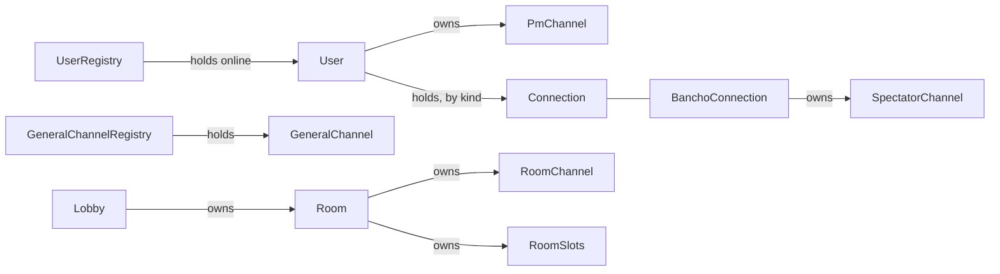
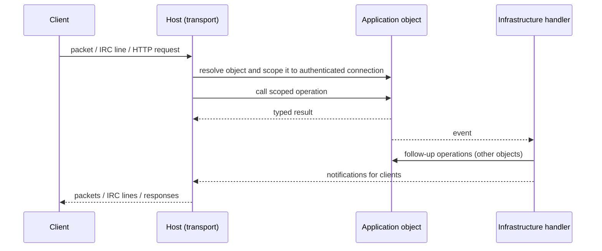

# Architecture

## Overview

Basil is a single deployable process with strict dependency direction. The Domain defines persistent business
values; Application objects own runtime state and behaviour and call small object-free services for the logic that
needs no live object; Infrastructure implements persistence and other capabilities; hosts translate client protocols
into Application operations.

```text
Basil.Domain                              business values                          -> (nothing)
Basil.Application.Persistence                 ports to the outside: persistence,       -> Domain
                                          capabilities, query records, paging
Basil.Application.Capabilities                object-free application logic            -> Application.Storage
                                          (every type internal)
Basil.Application.Runtime                 runtime objects, registries, root        -> Domain, Application.Storage,
                                          objects, scopes, contexts, events,          Application.Services
                                          AddApplication()
Basil.Infrastructure.Persistence              implements the persistence ports         -> Application.Storage
Basil.Infrastructure.Capabilities         implements the capability ports          -> Application.Storage
Basil.Infrastructure.Runtime              event buses, handlers, background work   -> Application.Objects
Basil.Protocol.Bancho / .Irc              wire formats                             -> external libraries only
Basil.Host.*                              transports                               -> Application.Objects,
                                                                                       Infrastructure, their Protocol
Basil.Host                                composition root                         -> all projects
Basil.Bot                     BasilBot commands and announcements      -> Application.Objects
```

> **Migration status (2026-10-21).** The Domain, Application, Infrastructure and BasilBot work described here
> is implemented. The hosts and every test project still use old namespaces; solution-wide `dotnet build`,
> `dotnet test` and architecture tests do not run. The host migration, `Basil.Cli`, tests and silent channel
> delivery for blocks remain unfinished. Build the migrated projects individually; see the verification note in
> [`AGENTS.md`](../../AGENTS.md).

## Projects and responsibilities

### `Basil.Domain`

Business models that exist beyond a single run of the server (`User`, `Match`, `Round`, `Score`,
`Beatmap`, `Login`, chat channel models, …), each guarding its own validity. It holds no runtime-only
state and no events, and references no other Basil project.

### `Basil.Protocol.Bancho` and `Basil.Protocol.Irc`

The Bancho and IRC wire formats. They are independent of every other project, so encoding and decoding
can be tested without starting the server. Bancho packet layouts are wire contracts.

### `Basil.Application.Persistence`

`Application.Storage` holds the ports to the outside of the process: repository and storage ports, query records and
paging, and the capability ports whose implementation needs external libraries (beatmapset reading, analysis, derived
assets, the beatmap mirror, screenshot inspection). It also holds the few plain data types that both Services and
Objects use in their signatures (login and registration inputs, score submission inputs, import and scan results).

### `Basil.Application.Capabilities`

`Application.Services` holds application logic that needs no live object: account checks, beatmapset indexing, score
validation and recording. It takes and returns records and plain results, never creates or receives a runtime
object, never publishes an event and keeps no running state. Every type is `internal`; only Objects uses it.

### `Basil.Application.Runtime`

`Application.Objects` holds the runtime objects, registries and root objects, their short-lived scoped views,
contexts, events and results, and every coordination between objects. It calls the services for object-free logic and
publishes the events they leave to it. Its public `AddApplication()` builds the contexts and objects and registers
the services. Object behaviour is never delegated to a service: each object owns the state, invariants and operations
for itself and its parts. See [Object scopes](#object-scopes).

### `Basil.Infrastructure`

Implementations of the storage ports (`Infrastructure.Storage`: PostgreSQL, files, memory) and capability ports
(`Infrastructure.Capabilities`: osu! rulesets, FFMpegCore, the beatmap mirror, ImageSharp), event buses and handlers, and
background loops (`Infrastructure.Runtime`).
`Infrastructure.Runtime` reacts to Application events by calling the owning object's operations, for example
when a connection closes or a restriction takes effect.

### `Basil.Host.Bancho`, `Basil.Host.Irc`, `Basil.Host.Api`

The transports decode their protocols, call Application operations and turn Application events into client
messages. The host projects still need migration to the new Application contracts.

### `Basil.Host`

The entry point and composition root: configuration, logging, host and subdomain routing, and
dependency-injection registration of every other project.

## Dependency rule

Dependencies point inwards only:

* Domain and the protocols reference nothing;
* Application.Storage references Domain;
* Application.Services references Application.Storage; Application.Objects references Domain, Application.Storage
  and Application.Services (Services' internals are visible to Objects only);
* Infrastructure.Storage and Infrastructure.Capabilities reference Application.Storage; Infrastructure.Runtime
  references Application.Objects; none references Application.Services;
* hosts reference Application.Objects, call `AddApplication()` and use the objects;
* only `Basil.Host` composes the full application.

When Application needs something outside the process (storage, files, network, the clock), it declares
a port and an outer project implements it. Application never creates a database connection, a file stream or
an Infrastructure type. The intended dependency rule is enforced by architecture tests once the test projects
are migrated; a project reference that breaks it is an architectural change.

## Object scopes

### Why ownership matters

Runtime state has owners: a room owns its slots, rounds and channel; a user owns its private-message channel while it
is online; a game connection owns its spectator channel. Keeping behaviour with that state prevents a central
service from becoming a procedural actor that must know every object's rules. Coordination that spans objects is a
method of the object that is acted on or of the registry that holds them. Cross-object reactions remain
separate and travel through events.

### How a scope works

The caller first gets the runtime object, then creates a short-lived view for its connection:

```csharp
channel.ScopeTo(by).Join();
await room.ScopeTo(by).Members.JoinAsync(password);
```

`ScopeTo(connection)` creates a `ScopedX` capability for one request or command. It captures the caller's
effective permissions and role on that object; callers must not keep the scope for later work. Operations on
the scope check authority and restrictions, then preserve the object's invariants, mutate its state and emit
events. Parts are reached through the owner (`room.ScopeTo(by).Slots`, `.Rounds`, `.Settings`, `.Authority`,
`.Members`), not through a service that takes the room as a parameter. No operation accepts a caller's
permissions as plumbing through lower layers.

System work that needs no caller permission uses the object directly. Examples include startup, public reads,
event handlers and BasilBot announcements. Actions requiring authority use a scope, including commands typed
in chat: the command uses the typist's connection, while BasilBot only sends the reply.

### Services

Services hold only logic that needs no live object (`AccountService`, `BeatmapsetIndexer`, `ScoreRecorder`). They have
no public contract, receive and return records and plain results, and never publish events: the object that called
them publishes what happened. The coordination itself belongs to an object: `UserRegistry` logs users in and opens,
closes and expires connections; `Lobby` releases connections from rooms, removes suspended members and referees and
recovers unfinished matches; `Room` records submitted scores for its round; `BanchoConnection` submits its player's
scores and reports anticheat flags; `Beatmapsets` imports and scans beatmapsets; `GeneralChannelRegistry` joins and
parts the automatic channels. Runtime objects such as `Room` and `User` have no parallel `IX` contract.


* **The acted-on object owns the interaction.** The relation belongs to the object acted on (`Channel.Members`,
  `Room.Slots`); its scope exposes the operation and the object emits the corresponding event.
* **Each object manages its own state.** `UserRegistry` opens and closes connections and announces those events;
  it does not clean up rooms or channels. Infrastructure handlers receive cross-object events and call the
  owning object's operation (`Lobby.ReleaseAsync`, `GeneralChannelRegistry.PartAll`). A room keeps its channel in step with its players and the lobby owns room closing.
* **Application publishes events; it never consumes them.** `IEventPublisher<T>` (`Publish`) is the only event port
  and `IEventHandler<T>` is the handler contract, both in Application.Objects; Services never publish. Infrastructure.Runtime implements the
  port with one `EventBus<T>` per event category, which delivers each event in order to the handlers in
  Infrastructure.Runtime or `Basil.Bot`.
* **Identity follows the basis object.** `Room` is identified by its `Match`, a general chat channel by its
  name. Recreated runtime objects compare by reference, so late cleanup carrying an old object cannot touch
  its replacement.
* **Setters only assign and validate.** Any change with consequences is an operation on the object that owns
  the state.

## Design

### Runtime objects and contexts

Runtime objects and their scoped views are in Application.Objects. Each object's `…Context` record supplies
only the ports and collaborators needed by its behaviour; the registration in Application.Objects builds these
contexts. The current context types are `RoomContext`, `UserContext`, `LobbyContext`, `ChannelContext`,
`SessionContext`, `BeatmapsetContext` and `ServerContext`. Contexts do not become a general service locator:
they keep an object's dependencies explicit and inside the Application boundary.

The object graph follows ownership:



Rooms, channels and the lobby hold connections, never users: membership is per client. A `User` is one live instance per
online period; an offline account gets a transient instance that is never registered.

### Feature folders

Application projects are sliced by feature; namespaces follow their project and folder.

| Feature | Application.Storage | Application.Services / Application.Objects |
|---|---|---|
| `Users/` | user, restriction, relationship, credential and login repositories; `UserQuery`; login and registration inputs | `AccountService` (Services); `User`, `UserRegistry`, scopes, restrictions, relationships and account results (Objects) |
| `Sessions/` | — | `Connection` and its kinds, `ScopedBanchoConnection`, user events (Objects) |
| `Chat/` | channel repository | `Channel` and its kinds, `GeneralChannelRegistry`, scopes and events (Objects) |
| `Multiplayer/` | match, round, score-relation repositories and query records | `Lobby`, `Room`, their scopes and events (Objects) |
| `Beatmaps/` | beatmapset and beatmap repositories and storage, capability ports, import and scan results | `BeatmapsetIndexer` (Services); `Beatmapset`, `Beatmapsets`, scope and events (Objects) |
| `Scores/` | score, replay and stats repositories; score submission inputs | `ScoreRecorder` (Services); score events (Objects) |
| `Anticheat/` | — | anticheat events (Objects) |
| `Content/` | content repositories and storage ports, the screenshot inspector port | content operations on `Server` |
| `Servers/` | — | `Server`, `ScopedServer` and server-wide resources (Objects) |

 `Events/` contains event types and contracts. `Sessions`, `Chat` and
`Multiplayer` form one runtime cluster because their state and invariants refer to each other. Their runtime
objects and registries are in Application.Objects.

### Events

Events form a category tree so a consumer can subscribe to a whole category:

```text
Event
├── UserEvent       UserConnectionOpened, UserConnectionClosed, UserConnectionStatusChanged, UserRestricted, UserRestrictionLifted, UserPermissionsChanged, UserNotificationSent
├── ChannelEvent    channel lifecycle, membership, messages, spectating
├── LobbyEvent          LobbyRoomOpened, LobbyRoomClosed, LobbyRoomClosingAnnounced, lobby watchers
├── RoomEvent           settings, slots, membership, authority, access, rounds
├── BeatmapsetEvent     BeatmapsetImported, BeatmapsetDeleted
├── ScoreEvent          ScoreSubmitted
└── AnticheatEvent      AnticheatPlayerFlagged
```

Events carry identities as references and changeable values as values captured when the event was
emitted (slot numbers, statuses), never a live slot.

### Ports

Ports describe capabilities an object or a service needs from another layer or subsystem. Application.Storage
declares model-specific repositories, file-storage ports and business capabilities such as beatmap analysis,
mirroring and screenshot inspection. Context records pass the needed ports to the runtime object. Runtime objects
are concrete types in Application.Objects, not ports; a port between two objects is implemented by whichever owns the
other (`Lobby` implements the room-lobby and connection-lobby ports).


Application publishes events but does not consume them. One `EventBus<T>` per event category queues what is
published and invokes the registered `IEventHandler<T>` handlers in order. Infrastructure.Runtime owns runtime handlers; BasilBot owns
command and announcement handlers. The hosts still need migration to the new Application contracts.



An event handler calls operations on the objects that own the affected state. It does not directly change
another object's state. Application objects use storage ports only for persistence and queries.

## Adding features

### Adding a Bancho packet or an IRC command

Decode it in the host, call the Application operation of the object it acts on, and translate the
typed result into a reply. Do not move rules into the transport because the request originated there:
if the rule is missing, add it to the acted-on object. See [`bancho.md`](bancho.md) and
[`irc.md`](irc.md).

### Adding a reaction to something that happens

Register a handler in the appropriate consumer (`Infrastructure.Runtime` or `Basil.Bot`) for the
relevant event category, then call the owning object's operation. Do not add an unrelated reaction to the
operation that caused the event.

### Adding persisted state

Add a model-specific repository contract in Application.Storage, implement it in Infrastructure.Storage and
register it in the composition root. A capability needing external libraries is a port in Application.Storage that
Infrastructure.Capabilities implements. Keep database code out of Application. See [`database.md`](database.md).

### Adding an HTTP endpoint

Add the route to the API host and delegate behaviour to Application. For the `api.` host, update the
OpenAPI contract with the route rather than maintaining a separate specification. See
[`response-envelope.md`](response-envelope.md), [`sse.md`](sse.md) and [`assets.md`](assets.md).

## Cross-cutting invariants

* Dependency direction is enforced by architecture tests after the test projects are migrated.
* Domain and the protocols remain dependency-free; Application.Services references only Application.Storage and has no public type.
* Runtime objects are separate from persisted state; Domain holds no runtime state or events.
* The acted-on object stores the relation and emits the event; sessions and connections do neither.
* Application publishes events and never consumes them; Services never publish.
* Permission-dependent room operations use `room.ScopeTo(by)`; read-modify-write transitions hold
  `room.EnterAsync()` across the complete transition.
* Privilege checks require every bit of the requirement.
* A shared channel is named `#name`; a private-message channel carries its owner's name without `#`.
* Privilege is named `Privilege`, never `Priv`.
* User-visible reply strings are centralized rather than duplicated.
* Performance points are not part of gameplay.

See [`working-scopes.md`](working-scopes.md) for features that are intentionally outside Basil's
scope.

## Related code

* `src/Application/Runtime/`: runtime objects, registries, scopes, contexts, events and `AddApplication()`.
* `src/Application/Capabilities/`: object-free application logic (internal).
* `src/Application/Persistence/`: repository, storage and capability ports, query records and paging.
* `src/Infrastructure/Persistence/`, `src/Infrastructure/Capabilities/`: implementations of those ports.
: event buses, handlers and background work.
* `src/Bot/`: BasilBot command and announcement handlers.

## Where to go from here

| Topic | Documentation |
|---|---|
| Bancho packet dispatch | [`bancho.md`](bancho.md) |
| Authentication and login | [`../for-client/bancho/authentication.md`](../for-client/bancho/authentication.md) |
| Multiplayer and match state | [`multiplayer.md`](multiplayer.md) |
| Chat, sessions and connections | [`chat.md`](chat.md) |
| HTTP live updates | [`sse.md`](sse.md) |
| API response envelope | [`response-envelope.md`](response-envelope.md) |
| Database and persistence | [`database.md`](database.md) |
| Beatmap ingestion | [`beatmap-ingestion.md`](beatmap-ingestion.md) |
| IRC architecture | [`irc.md`](irc.md) |
| Logging | [`logging.md`](logging.md) |
| Privileges | [`privileges.md`](privileges.md) |
| Development workflow | [`development.md`](development.md) |
| Deployment | [`../for-technicians/deployment.md`](../for-technicians/deployment.md) |
| Project scope | [`working-scopes.md`](working-scopes.md) |
