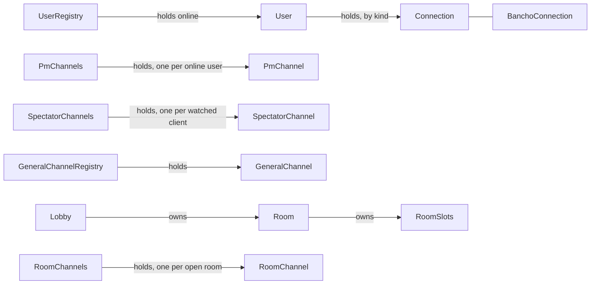
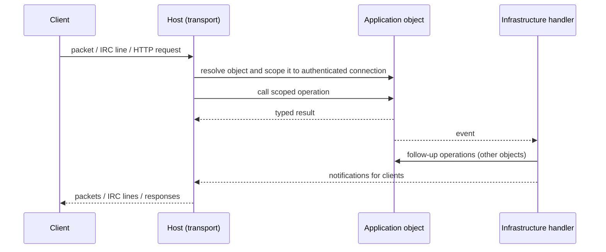

# Architecture

## Overview

Basil is a single deployable process with strict dependency direction. The Domain defines persistent business
values; Application objects own runtime state and behaviour and call small object-free services for the logic that
needs no live object; Infrastructure implements persistence and other capabilities; hosts translate client protocols
into Application operations.

```text
Basil.Domain                              business values                          -> (nothing)
Basil.Application.Common                 shared values and event contracts/queue   -> Domain, external packages
Basil.Infrastructure.Common              shared database, memory, files,            -> Application.Common, Domain
                                          migrations and event dispatcher
Basil.Application.<Module>               the module's ports and objects            -> Domain, Application.Common,
                                          (Persistence/, Capabilities/, Runtime/)      the Application projects of
                                                                                       the modules it uses
Basil.Infrastructure.<Module>            the module's implementations, DbContext   -> its own Application,
                                          and migrations, background work              Infrastructure.Common
Basil.Composition                         calls AddMediator once, AddBasil()       -> every module, Common.*
Basil.Protocol.Bancho / .Irc              wire formats                             -> external libraries only
Basil.Host.*                              transports                               -> Composition, their Protocol
Basil.Host                                composition root                         -> all projects
Basil.Bot                                 BasilBot commands and announcements      -> the Application projects of
                                                                                       the modules it uses
```

> **Migration status (2026-10-21).** The Domain, Application, Infrastructure and BasilBot work described here
> is implemented. The hosts and host test projects still use old namespaces; solution-wide `dotnet build`,
> `dotnet test` and architecture tests do not run. The host migration, `Basil.Cli`, tests and silent channel
> delivery for blocks remain unfinished. Build the migrated projects individually; see the verification note in
> [`AGENTS.md`](../../AGENTS.md).

## Projects and responsibilities

### `Basil.Domain`

Business models that exist beyond a single run of the server (`User`, `Match`, `Round`, `Score`,
`Beatmap`, `Login`, chat channel models, …), each guarding its own validity. It holds no runtime-only
state and no events, and references no other Basil project.

### `Basil.Protocol.Bancho` and `Basil.Protocol.Irc`

The Bancho and IRC wire formats. They are independent of every other project, so encoding and decoding
can be tested without starting the server. Bancho packet layouts are wire contracts.

### Module projects: `Basil.Application.<Module>` and `Basil.Infrastructure.<Module>`

**Why.** A module (Auth, Beatmaps, Chat, Content, Multiplayer, Scores, Servers, Users, Anticheat) owns one slice of
the business end to end. Splitting the code by module instead of by technique lets the compiler enforce which module may
use which: a project reference outside the graph below does not build, and `tests/Architecture/ModuleGraphTests.cs`
fails on it.

**What.** `Basil.Application.<Module>` holds three folders. `Persistence/` has the repository and storage ports and the
query records. `Capabilities/` has the ports whose implementation needs external libraries (beatmapset reading, analysis,
derived assets, the beatmap mirror, screenshot inspection; public) and the application logic that needs no live object
(account checks, beatmapset indexing, score validation and recording; internal, never creates or receives a runtime object
and never publishes an event). `Runtime/` has the runtime objects, registries and root objects, their short-lived scoped
views, contexts, feature events, handlers and every coordination between objects; object behaviour is never delegated to a
service. See [Object scopes](#object-scopes). Users and Connections are two folders of one project, `Basil.Users.*`,
because they reference each other. `Basil.Infrastructure.<Module>` implements the ports of its own Application project:
PostgreSQL (its own `DbContext`, with its own migration history), files, osu! rulesets, FFMpegCore, ImageSharp, and the
module's background work.

```text
Auth        -> Common
Beatmaps    -> Common
Content     -> Common
Users       -> Common, Auth, Content
Anticheat   -> Users
Scores      -> Users, Beatmaps
Multiplayer -> Users, Beatmaps, Content, Scores
Chat        -> Users, Multiplayer
Servers     -> every module above
```

**How.** Each project registers itself with a public `Add<Module>Application()` or `Add<Module>Infrastructure()`; its
contexts and constructors stay `internal`. Event handlers stay `internal` and a module that has them grants
`InternalsVisibleTo("Basil.Composition")` (the generated Mediator code names them) and to its own test project, nothing
more. A module that needs a member of another module gets it as a public member of the owning object, never through
`InternalsVisibleTo`.

### `Basil.Composition`

The one project that references every module. It calls `AddMediator` once, so the source generator finds the handlers of
every referenced module, and it holds the only reference to `Mediator.SourceGenerator`. Its public `AddBasil()` registers
the storage (`AddBasilStorage()`, with the migrations of the modules in the order of their foreign keys: Common, Users,
Auth, Beatmaps, Content, Scores, Multiplayer, Chat), the background work and the application objects
(`AddBasilApplication()`); the startup work that is not specific to one module (`StorageStartup`, `RuntimeStartup`)
lives here. The hosts call `AddBasil()`.

### `Basil.Application.Common` and `Basil.Infrastructure.Common`

The shared application project holds cross-feature values (`Result<T>`, `Scoped<T>`, paging and search syntax) and the
base event contract, publisher and queue. Its infrastructure partner owns the shared PostgreSQL, in-memory and file
implementations, common migration, and the event dispatcher. The application project depends on Domain; the
infrastructure project depends on both Application.Common and Domain.

### `Basil.Host.Bancho`, `Basil.Host.Irc`, `Basil.Host.Api`

The transports decode their protocols, call Application operations and turn Application events into client
messages. The host projects still need migration to the new Application contracts.

### `Basil.Host`

The entry point and composition root: configuration, logging, host and subdomain routing, and
dependency-injection registration of every other project.

## Dependency rule

Dependencies point inwards only:

* Domain and the protocols reference nothing;
* Application.Common references Domain; Infrastructure.Common references Application.Common and Domain;
* every module Application project references Domain, Application.Common and the Application projects of the modules it
  uses (the graph above); a module Infrastructure project references its own Application project, Infrastructure.Common
  and Application.Common, never another module;
* Composition references every module; hosts reference Composition, call `AddBasil()` and use the objects;
* only `Basil.Host` composes the full application.

When Application needs something outside the process (storage, files, network, the clock), it declares
a port and an outer project implements it. Application never creates a database connection, a file stream or
an Infrastructure type. The intended dependency rule is enforced by architecture tests once the test projects
are migrated; a project reference that breaks it is an architectural change.

## Object scopes

### Why ownership matters

Runtime state has owners: a room owns its slots and rounds; Chat keeps a room channel per open room, a private-message
channel per online user and a spectator channel per watched game client. Keeping behaviour with that state prevents a central
service from becoming a procedural actor that must know every object's rules. Coordination that spans objects is a
method of the object that is acted on or of the registry that holds them. Cross-object reactions remain
separate and travel through events.

### How a scope works

The caller first gets the runtime object, then creates a short-lived view for its connection:

```csharp
channel.ScopeTo(by).Join();
await room.ScopeTo(by).Members.JoinAsync(password);
```

`ScopeTo(connection)` creates a `ScopedX` capability for one request or command. It captures the caller's
effective permissions and role on that object; callers must not keep the scope for later work. Operations on
the scope check authority and restrictions, then preserve the object's invariants, mutate its state and emit
events. Parts are reached through the owner (`room.ScopeTo(by).Slots`, `.Rounds`, `.Settings`, `.Authority`,
`.Members`), not through a service that takes the room as a parameter. No operation accepts a caller's
permissions as plumbing through lower layers.

System work that needs no caller permission uses the object directly. Examples include startup, public reads,
event handlers and BasilBot announcements. Actions requiring authority use a scope, including commands typed
in chat: the command uses the typist's connection, while BasilBot only sends the reply.

### Services

Services hold only logic that needs no live object (`AccountService`, `BeatmapsetIndexer`, `ScoreRecorder`). They have
no public contract, receive and return records and plain results, and never publish events: the object that called
them publishes what happened. The coordination itself belongs to an object: `UserRegistry` logs users in and opens,
closes and expires connections; `Lobby` releases connections from rooms, removes suspended members and referees and
recovers unfinished matches; `Room` records submitted scores for its round; `ScoreSubmitter` takes a game client's
submitted score and `AnticheatReporter` reports its anticheat flags; `Beatmapsets` imports and scans beatmapsets;
`GeneralChannelRegistry` joins and parts the automatic channels. Runtime objects such as `Room` and `User` have no
parallel `IX` contract.


* **The acted-on object owns the interaction.** The relation belongs to the object acted on (`Channel.Members`,
  `Room.Slots`); its scope exposes the operation and the object emits the corresponding event.
* **Each object manages its own state.** `UserRegistry` opens and closes connections and announces those events;
  it does not clean up rooms or channels. Infrastructure handlers receive cross-object events and call the
  owning object's operation (`Lobby.ReleaseAsync`, `GeneralChannelRegistry.PartAll`). A room keeps its channel in step with its players and the lobby owns room closing.
* **Application publishes events and handles those of its own module; Infrastructure only ships them.**
  `IEventPublisher<T>` and the base event/queue live in Application.Common. Feature event categories and handlers remain
  in the owning module's Runtime folder; a handler is a `Mediator.INotificationHandler<TEvent>` for one event type, in Runtime or
  `Basil.Bot`. Infrastructure.Common runs the shared queue through `EventDispatcher`. Services never publish.
* **Identity follows the basis object.** `Room` is identified by its `Match`, a general chat channel by its
  name. Recreated runtime objects compare by reference, so late cleanup carrying an old object cannot touch
  its replacement.
* **Setters only assign and validate.** Any change with consequences is an operation on the object that owns
  the state.

## Design

### Runtime objects and contexts

Runtime objects and their scoped views are in the Runtime folder of their module. Each object's `…Context` record supplies
only the ports and collaborators needed by its behaviour; the module's `Add<Module>Application()` builds these
contexts. The current context types are `RoomContext`, `UserContext`, `LobbyContext`, `ChannelContext`,
`ConnectionContext`, `BeatmapsetContext` and `ServerContext`. Contexts do not become a general service locator:
they keep an object's dependencies explicit and inside the Application boundary.

The object graph follows ownership:



Rooms, channels and the lobby hold connections, never users: membership is per client. A `User` is one live instance per
online period; an offline account gets a transient instance that is never registered.

### Feature folders

Application projects are sliced by feature; namespaces follow their project and folder. Shared application and
infrastructure code is in `src/Application/Common` and `src/Infrastructure/Common` respectively.

| Feature | Persistence ports | Capabilities / Runtime |
|---|---|---|
| `Users/` | user, restriction, relationship, credential and login repositories; `UserQuery`; login and registration inputs | `AccountService` (Capabilities); `User`, `UserContext`, `UserRegistry`, `ScopedUser*`, `LoginResult`, `UserOutcome`, user events (Runtime) |
| `Connections/` | — | `Connection` and its kinds, `ConnectionContext`, `ScopedBanchoConnection`, connection rules and outcomes, connection and restriction handlers (Runtime) |
| `Chat/` | channel repository | `Channel` and its kinds, `GeneralChannelRegistry`, `PmChannels`, `SpectatorChannels`, scopes and events (Objects) |
| `Multiplayer/` | match, round, score-relation repositories and query records | `Lobby`, `Room`, their scopes and events (Objects) |
| `Beatmaps/` | beatmapset and beatmap repositories and storage, capability ports, import and scan results | `BeatmapsetIndexer` (Services); `Beatmapset`, `Beatmapsets`, scope and events (Objects) |
| `Scores/` | score, replay and stats repositories; score submission inputs | `ScoreRecorder` (Services); `ScoreSubmitter`, `ScopedScoreSubmitter`, score events (Objects) |
| `Anticheat/` | — | `AnticheatReporter`, anticheat events (Objects) |
| `Content/` | content repositories and storage ports, the screenshot inspector port | content operations on `Server` |
| `Servers/` | — | `Server`, `ScopedServer` and server-wide resources (Objects) |

  Feature event categories and handlers live with their owning module's Runtime folder; shared event contracts
  and the queue live in Application.Common. `Users` and `Connections` form one runtime cluster because a user holds its
  connections and a connection knows its user; `Chat` and `Multiplayer` refer to both. Their runtime
objects and registries are in the module's Runtime folder.

### Events

Events form a category tree so a consumer can subscribe to a whole category:

```text
Event
├── UserEvent       UserConnectionOpened, UserConnectionClosed, UserConnectionStatusChanged, UserRestricted, UserRestrictionLifted, UserPermissionsChanged, UserNotificationSent
├── ChannelEvent    channel lifecycle, membership, messages, spectating
├── LobbyEvent          LobbyRoomOpened, LobbyRoomClosed, LobbyRoomClosingAnnounced, lobby watchers
├── RoomEvent           settings, slots, membership, authority, access, rounds
├── BeatmapsetEvent     BeatmapsetImported, BeatmapsetDeleted
├── ScoreEvent          ScoreSubmitted
└── AnticheatEvent      AnticheatPlayerFlagged
```

Events carry identities as references and changeable values as values captured when the event was
emitted (slot numbers, statuses), never a live slot.

### Ports

Ports describe capabilities an object or a service needs from another layer or subsystem. Application.Storage
declares model-specific repositories, file-storage ports and business capabilities such as beatmap analysis,
mirroring and screenshot inspection. Context records pass the needed ports to the runtime object. Runtime objects
are concrete types in a module's Runtime folder, not ports; a port between two objects is implemented by whichever owns the
other (`Lobby` implements `IRoomLobbyPort` and answers the score module's `IScoreBeatmapAcceptance`).


Application publishes events and handles those of its own module. One shared queue (`EventQueue`, owned by
Application.Common), run by `EventDispatcher` in Infrastructure.Common, delivers every published event in order to its
`INotificationHandler<TEvent>` handlers;
The modules' Runtime folders own the runtime handlers and BasilBot owns command and announcement handlers. The hosts still need
migration to the new Application contracts.



An event handler calls operations on the objects that own the affected state. It does not directly change
another object's state. Application objects use storage ports only for persistence and queries.

## Adding features

### Adding a Bancho packet or an IRC command

Decode it in the host, call the Application operation of the object it acts on, and translate the
typed result into a reply. Do not move rules into the transport because the request originated there:
if the rule is missing, add it to the acted-on object. See [`bancho.md`](bancho.md) and
[`irc.md`](irc.md).

### Adding a reaction to something that happens

Register a handler in the appropriate consumer (a module's Runtime folder or `Basil.Bot`) for the
relevant event category, then call the owning object's operation. Do not add an unrelated reaction to the
operation that caused the event.

### Adding persisted state

Add a model-specific repository contract in the module's Application Persistence folder, implement it in the module's Infrastructure project and
register it in the composition root. A capability needing external libraries is a port in Application.Storage that
the module's Infrastructure project implements. Keep database code out of Application. See [`database.md`](database.md).

### Adding an HTTP endpoint

Add the route to the API host and delegate behaviour to Application. For the `api.` host, update the
OpenAPI contract with the route rather than maintaining a separate specification. See
[`response-envelope.md`](response-envelope.md), [`sse.md`](sse.md) and [`assets.md`](assets.md).

## Cross-cutting invariants

* Dependency direction is enforced by architecture tests after the test projects are migrated.
* Domain and the protocols remain dependency-free; Application.Services references only Application.Storage and has no public type.
* Runtime objects are separate from persisted state; Domain holds no runtime state or events.
* The acted-on object stores the relation and emits the event; sessions and connections do neither.
* Application publishes events and handles those of its own module; Infrastructure only ships them; Services never publish.
* Permission-dependent room operations use `room.ScopeTo(by)`; read-modify-write transitions are synchronous methods
  of `Room` that hold the room's own lock across the complete transition.
* Privilege checks require every bit of the requirement.
* A shared channel is named `#name`; a private-message channel carries its owner's name without `#`.
* Privilege is named `Privilege`, never `Priv`.
* User-visible reply strings are centralized rather than duplicated.
* Performance points are not part of gameplay.

See [`working-scopes.md`](working-scopes.md) for features that are intentionally outside Basil's
scope.

## Related code

* `src/Application/Common/`: shared application values and event contracts/queue.
* `src/Infrastructure/Common/`: shared database, memory, files and event dispatcher.
* `src/Application/<Module>/`: ports, object-free logic, runtime objects, feature events and `Add<Module>Application()`.
* `src/Infrastructure/<Module>/`: implementations of those ports, the module's `DbContext` and migrations.
* `src/Composition/`: `AddBasil()`, the one `AddMediator` call and the startup work.
* `src/Bot/`: BasilBot command and announcement handlers.

## Where to go from here

| Topic | Documentation |
|---|---|
| Bancho packet dispatch | [`bancho.md`](bancho.md) |
| Authentication and login | [`../for-client/bancho/authentication.md`](../for-client/bancho/authentication.md) |
| Multiplayer and match state | [`multiplayer.md`](multiplayer.md) |
| Chat, sessions and connections | [`chat.md`](chat.md) |
| HTTP live updates | [`sse.md`](sse.md) |
| API response envelope | [`response-envelope.md`](response-envelope.md) |
| Database and persistence | [`database.md`](database.md) |
| Beatmap ingestion | [`beatmap-ingestion.md`](beatmap-ingestion.md) |
| IRC architecture | [`irc.md`](irc.md) |
| Logging | [`logging.md`](logging.md) |
| Privileges | [`privileges.md`](privileges.md) |
| Development workflow | [`development.md`](development.md) |
| Deployment | [`../for-technicians/deployment.md`](../for-technicians/deployment.md) |
| Project scope | [`working-scopes.md`](working-scopes.md) |
