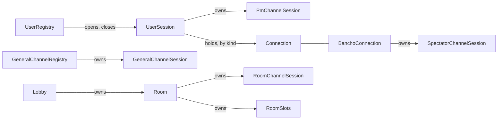
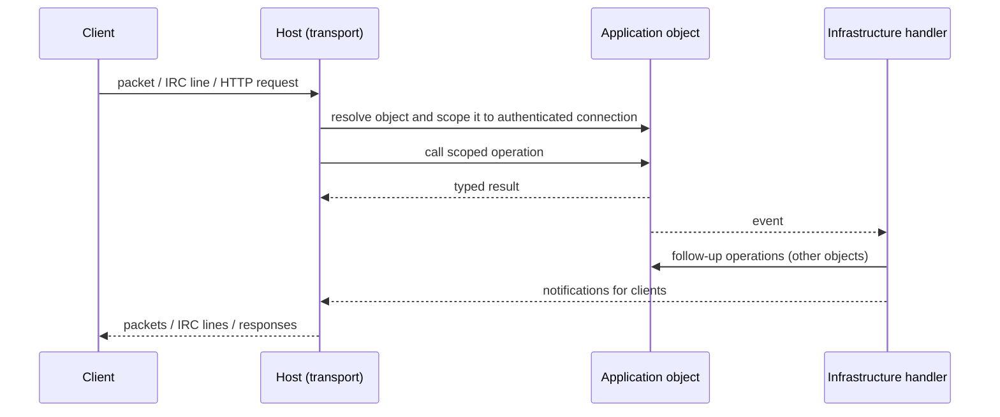

# Architecture

## Overview

Basil is a single deployable process with strict dependency direction. The Domain defines persistent business
values; Application objects own runtime state and behaviour; Infrastructure implements persistence and other
capabilities; hosts translate client protocols into Application operations.

```text
Basil.Domain                              business values                         -> (nothing)
Basil.Application.Storage       persistence ports, query records, paging -> Domain
Basil.Application.Objects     runtime objects, registry ports, scopes, -> Domain, Application.Storage
                                          contexts, events and service contracts
Basil.Application.Services registries, factories and services     -> Application.Objects,
                                                                                       Application.Storage
Basil.Infrastructure.Storage              persistence and file storage             -> Application.Storage
Basil.Infrastructure.Services             external capability providers             -> Application.Objects
Basil.Infrastructure.Runtime              event pumps, handlers and background work -> Application.Objects
Basil.Protocol.Bancho / .Irc               wire formats                              -> external libraries only
Basil.Host.*                               transports                               -> Application, Infrastructure,
                                                                                      their Protocol
Basil.Host                                 composition root                          -> all projects
Basil.Bot.Application                      BasilBot commands and announcements       -> Application.Objects
```

> **Migration status (2026-10-20).** The Domain, Application, Infrastructure and BasilBot work described here
> is implemented. The hosts and every test project still use old namespaces; solution-wide `dotnet build`,
> `dotnet test` and architecture tests do not run. The host migration, `Basil.Cli`, bot connection, tests and
> silent channel filtering for blocks remain unfinished. Build the migrated projects individually; see the
> verification note in [`AGENTS.md`](../../AGENTS.md).

## Projects and responsibilities

### `Basil.Domain`

Business models that exist beyond a single run of the server (`User`, `Match`, `Round`, `Score`,
`Beatmap`, `Login`, chat channel models, …), each guarding its own validity. It holds no runtime-only
state and no events, and references no other Basil project.

### `Basil.Protocol.Bancho` and `Basil.Protocol.Irc`

The Bancho and IRC wire formats. They are independent of every other project, so encoding and decoding
can be tested without starting the server. Bancho packet layouts are wire contracts.

### `Basil.Application.Storage`

`Application.Storage` contains repository and storage ports, query records and paging. Runtime registries are
defined by Application.Objects and implemented in Application.Services, alongside the objects they hold.

### `Basil.Application.Objects`

`Application.Objects` contains the runtime objects, their short-lived scoped views, contexts, events, results,
capability ports and the contracts of services that remain.

### `Basil.Application.Services`

`Application.Services` constructs the objects (factories and contexts in dependency injection), holds the registries
and implements cross-object or system operations. Object behaviour is not delegated to a service: each object
owns the state, invariants and operations for itself and its parts. See [Object scopes](#object-scopes).

### `Basil.Infrastructure`

Implementations of storage and capability ports, event dispatchers and handlers, and background loops.
`Infrastructure.Runtime` reacts to Application events by calling the owning object's operations, for example
when a connection closes or a restriction takes effect.

### `Basil.Host.Bancho`, `Basil.Host.Irc`, `Basil.Host.Api`

The transports decode their protocols, call Application operations and turn Application events into client
messages. The host projects still need migration to the new Application contracts.

### `Basil.Host`

The entry point and composition root: configuration, logging, host and subdomain routing, and
dependency-injection registration of every other project.

## Dependency rule

Dependencies point inwards only:

* Domain and the protocols reference nothing;
* Application.Storage references Domain;
* Application.Objects references Domain and Application.Storage; Application.Services references
  Application.Objects and Application.Storage;
* Infrastructure references contracts and protocols, never Application.Services;
* hosts reference Application.Services only to register it and use everything through contracts;
* only `Basil.Host` composes the full application.

When Application needs something outside the process (storage, files, network, the clock), it declares
a port and an outer project implements it. Application never creates a database connection, a file stream or
an Infrastructure type. The intended dependency rule is enforced by architecture tests once the test projects
are migrated; a project reference that breaks it is an architectural change.

## Object scopes

### Why ownership matters

Runtime state has owners: a room owns its slots, rounds and channel; a user session owns its private-message
channel; a game connection owns its spectator channel. Keeping behaviour with that state prevents a central
service from becoming a procedural actor that must know every object's rules. Cross-object reactions remain
separate and travel through events.

### How a scope works

The caller first gets the runtime object, then creates a short-lived view for its connection:

```csharp
channel.ScopeTo(by).Join();
await room.ScopeTo(by).Members.JoinAsync(password);
```

`ScopeTo(connection)` creates a `ScopedX` capability for one request or command. It captures the caller's
effective permissions and role on that object; callers must not keep the scope for later work. Operations on
the scope check authority and restrictions, then preserve the object's invariants, mutate its state and emit
events. Parts are reached through the owner (`room.ScopeTo(by).Slots`, `.Rounds`, `.Settings`, `.Authority`,
`.Members`), not through a service that takes the room as a parameter. No operation accepts a caller's
permissions as plumbing through lower layers.

System work that needs no caller permission uses the object directly. Examples include startup, public reads,
event handlers and BasilBot announcements. Actions requiring authority use a scope, including commands typed
in chat: the command uses the typist's connection, while BasilBot only sends the reply.

### Services that remain

Services remain for work that coordinates multiple objects or represents a system capability, not to perform
one object's behaviour for it. `IAuthService` coordinates login and registration; `IBeatmapsetService` imports
and scans beatmapsets; `IScoreService` submits scores while coordinating player statistics, the room round and
anticheat; `IAnticheatService` judges client flags; `IMatchService` provides match-level operations; and
`ISessionConnectionsService` opens, closes and expires connections. `IRoomService` retains system-only room
operations such as recording a submitted score and removing a suspended member. `IChannelService` handles
automatic channel joins and parts. Each service contract lists an actual public capability; runtime objects
such as `Room` and `User` have no parallel `IX` service contract.

### Ownership and events

* **The acted-on object owns the interaction.** The relation belongs to the object acted on (`ChannelSession.Members`,
  `Room.Slots`); its scope exposes the operation and the object emits the corresponding event.
* **Each object manages its own state.** `UserRegistry` opens and closes connections and announces those events;
  it does not clean up rooms or channels. Infrastructure handlers receive cross-object events and call the
  owning object's operation. A room keeps its channel in step with its players and the lobby owns room closing.
* **Application emits events; it never consumes them.** `IEventPublisher<T>` exposes event streams and
  `IEventHandler<T>` is the handler contract in Application.Objects. One Infrastructure dispatcher reads each
  stream and fans events out to handlers in Infrastructure.Runtime or `Basil.Bot.Application`.
* **Identity follows the basis object.** `Room` is identified by its `Match`, a general chat channel by its
  name. Recreated runtime objects compare by reference, so late cleanup carrying an old object cannot touch
  its replacement.
* **Setters only assign and validate.** Any change with consequences is an operation on the object that owns
  the state.

## Design

### Runtime objects and contexts

Runtime objects and their scoped views are in Application.Objects. Each object's `…Context` record supplies
only the ports and collaborators needed by its behaviour; the factory in Application.Services builds these
contexts. The current context types are `RoomContext`, `UserContext`, `LobbyContext`, `ChannelContext`,
`SessionContext`, `BeatmapsetContext` and `ServerContext`. Contexts do not become a general service locator:
they keep an object's dependencies explicit and inside the Application boundary.

The object graph follows ownership:



Rooms, channels and the lobby hold connections, never sessions: membership is per client.

### Feature folders

Application projects are sliced by feature; namespaces follow their project and folder.

| Feature | Application.Storage | Application.Objects / Application.Services |
|---|---|---|
| `Users/` | user, restriction and relationship repositories; `UserQuery` | `User`, `ScopedUser`, restrictions, relationships and account results |
| `Auth/` | credential and login repositories | `IAuthService` and login or registration inputs |
| `Sessions/` | session-related persistent ports | `UserSession`, `Connection`, `IUserRegistry`, `ISessionConnectionsService` and scopes (Application.Objects); `UserRegistry`, `SessionConnectionsService` (Application.Services), and events |
| `Chat/` | channel repository | channel objects and scopes, `IGeneralChannelRegistry`, `IChannelService` (Application.Objects); `GeneralChannelRegistry`, `ChannelService` (Application.Services), and events |
| `Multiplayer/` | match, round, score-relation repositories and query records | `Lobby`, `Room`, their scopes, `IMatchService` and system-only `IRoomService` operations |
| `Beatmaps/` | beatmapset and beatmap repositories and storage | `Beatmapset`, its scope, `IBeatmapsetService` and capability ports |
| `Scores/` | score, replay and stats repositories | `IScoreService` and score events |
| `Anticheat/` | — | `IAnticheatService` and anticheat events |
| `Content/` | content repositories and storage ports | content operations on `Server` |
| `Servers/` | — | `Server`, `ScopedServer` and server-wide resources |

`Common/` contains storage paging values; `Events/` contains event types and contracts. `Sessions`, `Chat` and
`Multiplayer` form one runtime cluster because their state and invariants refer to each other. Their runtime
objects and registries are in Application.Objects; registry implementations are in Application.Services.

### Events

Events form a category tree so a consumer can subscribe to a whole category:

```text
Event
├── UserEvent       UserConnectionOpened, UserConnectionClosed, UserConnectionStatusChanged, UserRestricted, UserRestrictionLifted, UserPermissionsChanged
├── ChannelEvent    channel lifecycle, membership, messages, spectating
├── LobbyEvent          LobbyRoomOpened, LobbyRoomClosed, LobbyRoomClosingAnnounced, lobby watchers
├── RoomEvent           settings, slots, membership, authority, access, rounds
└── BeatmapsetEvent        BeatmapsetImported
```

Events carry identities as references and changeable values as values captured when the event was
emitted (slot numbers, statuses), never a live slot.

### Ports

Ports describe capabilities an object needs from another layer or subsystem. Application.Storage declares
model-specific repositories and file-storage ports; Application.Objects declares business capabilities such as
beatmap analysis and mirroring. Context records pass the needed ports to the runtime object. Runtime objects
are concrete types in Application.Objects, not ports. Objects have no `IX` service contracts; service contracts
remain for coordination and system operations that are public capabilities.

## Events across objects

Application publishes events but does not consume them. One dispatcher reads each event stream and invokes
the registered `IEventHandler<T>` handlers. Infrastructure.Runtime owns runtime handlers; BasilBot owns
command and announcement handlers. The hosts still need migration to the new Application contracts.



An event handler calls operations on the objects that own the affected state. It does not directly change
another object's state. Application objects use storage ports only for persistence and queries.

## Adding features

### Adding a Bancho packet or an IRC command

Decode it in the host, call the Application operation of the object it acts on, and translate the
typed result into a reply. Do not move rules into the transport because the request originated there:
if the rule is missing, add it to the acted-on object. See [`bancho.md`](bancho.md) and
[`irc.md`](irc.md).

### Adding a reaction to something that happens

Register a handler in the appropriate consumer (`Infrastructure.Runtime` or `Basil.Bot.Application`) for the
relevant event category, then call the owning object's operation. Do not add an unrelated reaction to the
operation that caused the event.

### Adding persisted state

Add a model-specific repository contract in Application.Storage, implement it in Infrastructure.Storage and
register it in the composition root. Keep database code out of Application. See [`database.md`](database.md).

### Adding an HTTP endpoint

Add the route to the API host and delegate behaviour to Application. For the `api.` host, update the
OpenAPI contract with the route rather than maintaining a separate specification. See
[`response-envelope.md`](response-envelope.md), [`sse.md`](sse.md) and [`assets.md`](assets.md).

## Cross-cutting invariants

* Dependency direction is enforced by architecture tests after the test projects are migrated.
* Domain and the protocols remain dependency-free; Application.Objects references Domain and Application.Storage.
* Runtime objects are separate from persisted state; Domain holds no runtime state or events.
* The acted-on object stores the relation and emits the event; sessions and connections do neither.
* Application emits events and never consumes them.
* Permission-dependent room operations use `room.ScopeTo(by)`; read-modify-write transitions hold
  `room.EnterAsync()` across the complete transition.
* Privilege checks require every bit of the requirement.
* A shared channel is named `#name`; a private-message channel carries its owner's name without `#`.
* Privilege is named `Privilege`, never `Priv`.
* User-visible reply strings are centralized rather than duplicated.
* Performance points are not part of gameplay.

See [`working-scopes.md`](working-scopes.md) for features that are intentionally outside Basil's
scope.

## Related code

* `src/Application/Objects/`: runtime objects, scopes, contexts, events and service contracts.
* `src/Application/Services/`: object factories and remaining service implementations.
* `src/Application/Storage/`: repository, storage and registry contracts.
* `src/Infrastructure/Runtime/`: event dispatchers, handlers and background work.
* `src/Bot/Application/`: BasilBot command and announcement handlers.

## Where to go from here

| Topic | Documentation |
|---|---|
| Bancho packet dispatch | [`bancho.md`](bancho.md) |
| Authentication and login | [`../for-client/bancho/authentication.md`](../for-client/bancho/authentication.md) |
| Multiplayer and match state | [`multiplayer.md`](multiplayer.md) |
| Chat, sessions and connections | [`chat.md`](chat.md) |
| HTTP live updates | [`sse.md`](sse.md) |
| API response envelope | [`response-envelope.md`](response-envelope.md) |
| Database and persistence | [`database.md`](database.md) |
| Beatmap ingestion | [`beatmap-ingestion.md`](beatmap-ingestion.md) |
| IRC architecture | [`irc.md`](irc.md) |
| Logging | [`logging.md`](logging.md) |
| Privileges | [`privileges.md`](privileges.md) |
| Development workflow | [`development.md`](development.md) |
| Deployment | [`../for-technicians/deployment.md`](../for-technicians/deployment.md) |
| Project scope | [`working-scopes.md`](working-scopes.md) |
