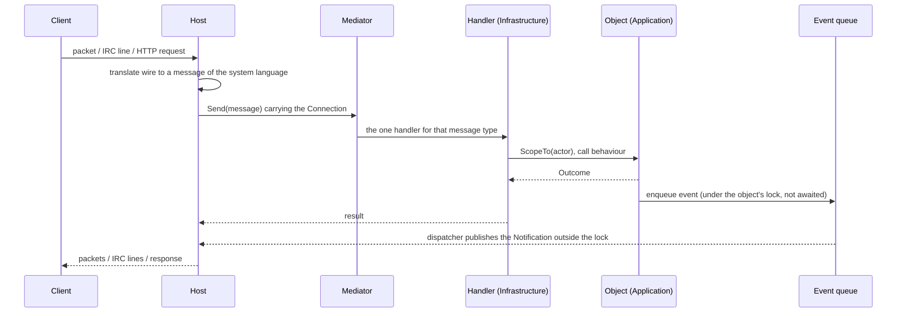

# Architecture

## Overview

Basil is a single deployable process: a modular monolith. It is cut twice. Horizontally, by layer: Domain is the system at
rest, Application is the running system and its contracts, Infrastructure implements the contracts. Vertically, by
module: each module owns one slice of the business end to end and may use only the modules below it in a fixed graph.
Around that core sit four kinds of project that do not hold business rules: Protocol (the translation language of the
wire), Hosts (translate and dispatch), Gateway (admission control) and the Server (the way to run it all).

> **Migration status.** This page describes the target architecture. Where the code does not match yet, the
> difference is listed in [`migration-status.md`](migration-status.md); where this page and the code disagree, the code is
> the state and this page is the direction.

## Layers

| Layer | Is | Holds | Does not hold |
|---|---|---|---|
| Domain | the system at rest | durable models (what is stored) and the rules of one object on its own: validity of data, its state, invariants and transitions that touch only itself, constants and enums of the rules, pure computation | repositories, events, timers, live objects of another module, connections, I/O |
| Application | contracts plus the running system | runtime objects (`User`, `Session`, `Room`, channels), registries, capabilities, Mediator messages, and the contracts of services, ports, repositories and storages | implementations, third-party libraries |
| Infrastructure | the implementations of those contracts | EF rows, handlers, service implementations, adapters, workers | contracts other layers depend on |

Each part of the system has one job, and the job decides where a line of code goes (owner decision 2026-11-25):

* **Gateway** guards the system. It blocks and rate-limits each request, as a doorman keeps strangers out, and does
  nothing else.
* **Host** translates. Inbound it turns what the outside world sends into the system's own language (its messages) and
  routes it to the handler or service that processes it; outbound it turns the system's language back into the outside
  one and sends it. It holds no system logic at all: a host only routes.
* **Protocol** defines the languages the outside world does not already provide, such as the osu! client's and IRC.
* **Application** receives the requests from the hosts and processes them through its contracts.
* **Infrastructure** provides Application with third-party services.
* **Domain** is the core: the business and its rules, the objects Application processes.

When a rule needs data the core does not receive, the message carries that data into the core; the rule never moves
out to the host. A rule that the core cannot check at all is not a rule of the system.

A type belongs to Domain only if it is stored or is a rule that stays true offline. A type that only means something while
the system runs (session state, presence, spectator frames, the state of a room in play) belongs to Application of the module
that owns it. A row that carries data to the database is not a Domain model; it is an Infrastructure row.

```text
Basil.Shared                     primitives with no business meaning             -> (nothing)
Basil.Domain                     the system at rest                              -> Shared
Basil.Application.Shared         shared contracts, events, Mediator         -> Domain, Mediator.Abstractions
Basil.Infrastructure.Shared      shared database, files, event dispatcher         -> Application.Shared, Domain
Basil.Application.<Module>       contracts and runtime objects of one module      -> Domain, Application.Shared,
                                                                                     the Application projects it uses
Basil.Infrastructure.<Module>    implementations of that module's contracts       -> its own Application,
                                                                                     Infrastructure.Shared
Basil.Infrastructure.Persistence    Npgsql design-time factories and all            -> Infrastructure.Shared, the
                                 PostgreSQL migrations;                              module Infrastructure projects
                                 only Basil references it
Basil.Protocol.Game.Stable / .Irc     the translation language of each wire            -> Domain / nothing
Basil.Gateway                    admission control                                -> (nothing but the rate-limiting library)
Basil.Host.Shared                views and outcome-to-error mapping               -> Application projects
Basil.Host.Stable/.Irc/.Rest/.Cli  transports                                     -> Host.Shared, Protocol, Gateway, Application
Basil                            composition root -> everything
```

The project graph is checked in review; no test in the repository enforces it yet.

## Modules

A module owns one slice of the business. The project references enforce which module may use which:

```text
Rulesets     -> Shared
Beatmaps     -> Shared, Rulesets
Content      -> Shared
Users        -> Shared, Content
Sessions     -> Users
Anticheat    -> Users, Sessions
Scores       -> Users, Sessions, Beatmaps, Rulesets
Multiplayer  -> Users, Sessions, Beatmaps, Content, Scores
Chat         -> Users, Sessions, Multiplayer
Diagnostics  -> Users, Sessions
Servers      -> every module above
Bot          -> Anticheat, Beatmaps, Chat, Multiplayer, Scores, Servers, Sessions, Users
```

Each module is two projects. `Basil.Application.<Module>` holds only contracts and runtime objects.
`Basil.Infrastructure.<Module>` holds only implementations of those contracts and may use third-party libraries. A module
Infrastructure project never references another module's projects; foreign keys between module databases decide only the
order in which migrations are registered. Folder-by-folder detail is in [`../for-agents/application-design.md`](../for-agents/application-design.md).

### The service ladder

Application code is arranged in four levels. A level uses only the levels below it.

```text
Service      a system operation with a contract ("log in", "import a beatmapset", "report a flag")
Ports        capabilities whose implementation needs external computation or libraries (beatmapset reader, analyser)
Stores       Registry (live objects in RAM) | Repository (rows, awaited) | Storage (files)
Objects      runtime objects that own state, invariants and behaviour (User, Connection, Room, Channel)
```

* **Registry** keeps live objects in RAM and hands them out. It holds runtime state only.
* **Repository** awaits the database. Small records may be cached cache-aside; a large or streamed payload never is.
* **Storage** holds files and media (beatmapsets, replays, avatars). Images are served as stored files
  ([`assets.md`](assets.md)).

### How layers call each other

* A relation between different levels (a service using a store, a port or an object) is a direct call through
  dependency injection.
* A relation between peers (a service reacting to what another service did, a host asking a module to act) goes through
  **Mediator**: a Command or Query is sent, a Notification is published. Mediator itself belongs to Application (only
  `Mediator.Abstractions`); Infrastructure implements the handlers.
* A **Handler** is the Mediator listener for one message type. It is thin, one class per message type, `internal`, and it
  lives in `Infrastructure.<Module>/Handlers`. It scopes the object to the message's actor and calls its behaviour.
* A handler that translates a Notification to a wire (Notification to packets or lines) lives in the host that owns that
  wire (the IRC host's `Delivery/` folder is the model).

### Messages

A message is a Mediator **request**: a `record` in the owning module's Application project that implements
`IRequest<TResponse>` and carries the `Session` of the caller as `Actor` (a login carries none, because it creates the
`Session`). Mediator maps each request type to exactly one handler, so the host never names a handler.

* A command changes state and answers the outcome enum of the object it acts on; a query reads and
  answers a view or `null`. Both are requests; the name says which (`PostChatMessage`, `GetLeaderboard`).
* A message addresses things by identity, not by a transport's spelling: chat uses a `ChatTarget` (a general channel's
  name, a room's id, a user's id), never an IRC `#name` or an osu! alias. The host translates its own spelling.
* A message is a public type of Application; its handler is `internal` in Infrastructure and the `Basil` project is made
  a friend of that assembly, because the one `AddMediator` call there generates the dispatch.
* Pipeline behaviors apply to requests only; a Notification never passes through them.
* Notifications are published by the event dispatcher, one handler after another; a handler that throws is logged and
  the others still run (see below).

## The osu! calculation stack

Star ratings, pp and beatmapset reading use osu!'s own libraries (`osu.Game`, the four rulesets, `osu.Framework` and the
few managed assemblies the calculation loads). The image carries none of them: the projects compile against the packages
with `PrivateAssets="all"` (so nothing reaches the publish output) and the program resolves the assemblies at run time
from `Data/Rulesets/<version>/`. `ExcludeAssets="runtime"` does not restore, because the language packs of `Humanizer`
that `osu.Game` pulls hold only resources.

* **Manifest.** `Basil.Infrastructure.Rulesets/rulesets.manifest.json`, embedded in the program, lists the packages, the
  version, the SHA-512 of each package file and the SHA-256 of each file taken from it. `tools/RulesetManifest` writes it:
  it runs the calculators and the beatmapset reader over the sample beatmaps, records every assembly loaded, then proves the
  list by running again with only those files reachable and once more with none. Run it when the `ppy.*` version changes;
  `--check` fails when the committed file differs.
* **Store.** `RulesetStore` registers the assembly resolution before any osu! type is used, checks the folder against the
  manifest on every start (`Installed`, `Missing`, `Damaged`) and checks a file again when it is loaded. Anything but
  `Installed` turns the feature off; the server keeps running.
* **Feature off.** The analyser and calculator answer `null`, the importer refuses with `rulesetsMissing`, and both beatmapset
  scans change nothing, so an unread archive is never taken for a broken one. The guard sits in a method that names no
  osu! type: the runtime needs an assembly when a method is compiled, not when its line runs.
* **Install.** `ruleset update` downloads each package from the feed, checks it and every file, and moves the folder into
  place in one step. A first install turns the feature on at once and publishes `RulesetsUpdated`, which starts the scan of
  the waiting archives; a repair of a stack already in use answers `restartRequired`.

Related code: `Basil.Infrastructure.Rulesets/Storage/RulesetStore.cs`, `Services/RulesetUpdater.cs`, `tools/RulesetManifest/`.

## Events and locks

An object publishes an event while it holds its own lock (a `Room` changes state and announces it in one transition).
Notifications are therefore **never awaited under a lock**: the object enqueues the event on the shared event queue
(`EventQueue`, Infrastructure.Shared) and returns at once, and a dispatcher in Infrastructure.Shared (`EventDispatcher`)
calls the Mediator handlers outside the lock, in order. No code calls `await mediator.Publish(...)` at the place where it
emits. The queue is unbounded; rate limiting and the `Outstanding` count in diagnostics watch its size.

### Lanes

The queue has one reader per **lane**, a category of events, so a handler that waits (a database read, a recorder) holds up
only the events of its own lane. An event type declares its lane with `[EventLane(...)]` on the base record of its
category, and every derived event inherits it (`EventLaneAttribute`, Application.Shared):

| Lane | Events |
|---|---|
| `Chat` | `ChannelEvent`: channels, their members and messages |
| `Presence` | `SessionEvent` (including spectators) and `UserEvent`: who is connected, their status and standing |
| `Multiplayer` | `RoomEvent`, `LobbyEvent` and `ScoreEvent` (a submitted score is applied to the room's round) |
| `General` | everything else (beatmaps, rulesets, anticheat, diagnostics) |

Inside a lane, events are delivered one at a time in the order they were published. **Across lanes no order is promised**:
a handler must not rely on an event of one lane being delivered before or after an event of another. What needs order
shares a lane, and the consequence of an event that a handler publishes goes to that event's own lane (a room event's
handler that opens a channel publishes a chat event, delivered after the chat events already waiting). Handlers of
different lanes run at the same time, so the objects they call are thread-safe by their own lock. `Outstanding`,
`Published` and `Failures` count over all lanes, and a drain empties every lane.

### Waiting for the deliveries of one request

A host that must answer with the effect of what it just handled (the osu! poll) opens a scope with
`IPublishedEvents.Track()` around the dispatch, then awaits `DeliveredAsync(limit)`: it completes when the events
published from that flow have been delivered, or when the limit passes. Only first-level events are awaited; no
scope, or nothing published, means no wait. The hosts reach it through the contract in Application.Shared, never through
`EventQueue`.



## The edge of the system

### Protocol: the translation language

`Basil.Protocol.Game.Stable` and `Basil.Protocol.Irc` are the vocabulary and grammar of each wire: the osu! binary packets, IRC
lines, the delimited strings of the web endpoints, and the client's own encoding (the score submission cipher). They are
C# models of primitives. They do not validate, give no business meaning and coordinate nothing. A host uses Protocol to
read and write its wire, checks what the client sent (`WireMap.Known`, `WireMap.Mods`) and builds a message of the
system's language. Only the transports that speak a protocol reference it; Application and Infrastructure never do. If a
wire format changes, only Protocol changes. `Protocol.Game.Stable` references Domain because the game enums carry the client's
numbering; `Protocol.Irc` references nothing.

### Hosts: translate and dispatch

`Basil.Host.Stable`, `.Irc`, `.Rest` and `.Cli` translate. Inbound, a host receives a packet, line or request, translates it
with Protocol into a strongly typed message of the system language (not flattened), and sends it through Mediator to a
service. Outbound, a host listens to Notifications and translates them to its wire. A host holds no business rule, no
privilege rule and no state. A host never calls `ScopeTo`, never references Infrastructure, and never
references another host. `Basil.Host.Shared` holds the views and the table that turns an outcome into an API error code; it holds no
ASP.NET types.

A host holds no repository and no storage: it does not take one by constructor, field or route parameter, and it does not
ask the service provider for one. Every read a host needs is a query message answered in the owning module. A read that
depends on the caller's privileges carries the caller's `Session`; a public read (images, beatmap downloads, the menu, the
FAQ, scores, an account's public profile) carries no actor. The checks that admit a request (upload limits, rate limits, the
allowed origins, the message of the day) have no exception: they send the public `ReadSettings` message, which the
cache-aside settings repository answers from memory. A message names an account by `int TargetId` and a stored thing by
its id (`int SetId`, `int MatchId`), so the answer to "does it exist" comes only after the module has checked the caller's
privileges. This rule is checked in review.

### How the host knows whose request it is

* **Which handler?** The host does not choose a handler. It chooses a **message type** from the wire (an HTTP route, a
  packet id, an IRC command) and sends it. Mediator maps a message type to exactly one handler at compile time. The host
  knows only the message record in `Application.<Module>`, not the handler or the module that implements it.
* **Whose request?** Every transport session is bound to a `Session`, an object of the Sessions module. Logging in is a
  Command with no actor and returns the `Session`. On Rest the token is resolved by a Query to a `Session` that is
  attached to the request; on Stable the polling request carries the `osu-token`; on IRC the socket keeps the
  `Session` after PASS and NICK. Every later message carries the `Session` as its actor, and the handler
  calls `object.ScopeTo(message.Actor)`; the capability computes effective privileges and checks them with `Lacks`.
* **Unforgeable.** Only the Sessions module creates a `Session` (its constructors are `internal`), so a host cannot build one.
  A bad token resolves to nothing and the host answers 401 before any business message is built.

### Gateway: admission control

`Basil.Gateway` is the guard of the system. It answers one question about each incoming request, `Allow` or `Deny`
(with a reason code and a retry delay), from rate, concurrency and load. To protect per object (a user, a session, a
room) it may use the Application services and capabilities (owner decision 2026-11-25), but it only guards: it
translates nothing, dispatches nothing and never processes the request itself. The host enforces the answer in its protocol. Every per-address rule, the size a body declares and TLS belong
to nginx in front of Basil, not to the Gateway. The design is in [`gateway.md`](gateway.md), the split with nginx in
[`edge.md`](edge.md).

### Server: the way to run it

The project `Basil` is the composition root: it builds dependency injection, binds
configuration, chooses Kestrel and its plain-HTTP ports, wires hosts, gateway and modules, owns logging and
the lifecycle (start and stop) and `Program.cs`. It holds no certificate: nginx ends TLS. It calls `AddMediator` once so the generated code finds every
handler. It sees the whole system in order to run it, but means nothing to the hosts or the gateway: none of them knows it
exists. It contains no business object, no recovery logic and no admission policy.

## Dependency rules

* Domain and Protocol.Irc reference nothing; Protocol.Game.Stable references Domain only.
* Application.Shared references Domain; Infrastructure.Shared references Application.Shared and Domain.
* A module Application project references Domain, Application.Shared and the Application projects of the modules it uses.
  A module Infrastructure project references its own Application project, Infrastructure.Shared and Application.Shared,
  never another module.
* Application never creates a database connection, a file stream or an Infrastructure type; it declares a contract and the
  outer project implements it.
* Hosts reference `Host.Shared`, Protocol, Gateway and Application projects; they never reference Infrastructure or another
  host. Rest and Cli never reference `Protocol.Game.Stable`. **(target)** for the Infrastructure part.
* Only the Server references everything.
* Options belong to the project that defines them: that project binds them (`Add<Module>...(IConfiguration)`), keeping
  every key path. `Basil` binds only what it defines (server, logging, telemetry, updates); see
  [`migration-status.md`](migration-status.md).

## Object capabilities

Runtime state has owners: a room owns its slots and rounds; Chat keeps a room channel per open room, a private-message
channel per online user and a spectator channel per watched game client. Behaviour stays with the state it changes.

The caller gets the runtime object and then a capability (`Scoped*`, called Cap in the design notes) for its connection:

```text
channel.ScopeTo(actor).Join();
room.ScopeTo(actor).Members.JoinAsync(password);
```

A capability is a `readonly struct` valid for one request. It snapshots the actor's effective privileges once, offers
forwarding getters for the owner's parts, and calls the owner's `internal` raw mutators. Behaviours that can be refused return
the outcome enum of the object. A capability is never stored in a field or property (checked in review). System work
with no caller (startup, event handlers reacting for the server, announcements) calls the object directly.

## Sessions

A session is one sign-in on one connection: one token, one row in `sessions`. It is alive while its client keeps
sending heartbeats; after a silence it can be replaced or expires, and only API sessions survive a restart.
Session types are Stable, StableTourney (the osu!tourney client and observers), Irc and Api. BasilBot is a module bound
to user id 1 that holds exactly one Stable and one Irc session and has no session type of its own; see
[`../for-agents/identity-privileges.md`](../for-agents/identity-privileges.md), which also owns the one-session-per-type rule.

## Streaming

Data reaches its consumer directly. A database read is bounded, loaded, the connection released, and only then sent. Every
upload is written into its storage's temporary file, validated, then moved atomically into place. Application code does not buffer a
payload in a `MemoryStream`. The mandatory rule is in [`../../AGENTS.md`](../../AGENTS.md).

## Live updates

Every live HTTP route is under `Basil.Host.Rest` and uses one hub. A stream belongs to a root (a player, a room, a match,
the server); the hub bundles events once a second, serializes the bundle once and hands the same bytes to every stream of
that root. The first event is a snapshot. See [`sse.md`](sse.md).

## Adding features

* **An osu! (stable) packet or IRC command:** add a message record in the owning module's Application project, a handler in
  its Infrastructure project, and the host's translation from the wire to the message. Add a missing rule to the object,
  not to the host.
* **A reaction:** a handler for the Notification in the owning module's `Infrastructure.<Module>/Handlers`, or in the
  host that owns the wire for a Notification-to-wire handler.
* **Persisted state:** add a repository contract in the module's Application `Persistence/` and implement it in the
  module's Infrastructure project. No SQL text anywhere.
* **An HTTP endpoint:** add a route in `Basil.Host.Rest` that translates and sends, declare its admission policy in the
  gateway, and let the generated OpenAPI describe the contract.

## Invariants

* Dependencies point down; the module and host graphs are checked in review.
* Domain is dependency-free, holds no lock, and holds every business operation of one object; Application only exposes contracts and coordinates objects, connections, locks and timers.
* The acted-on object stores the relation and emits the event.
* A notification is never awaited under a lock; objects enqueue, a dispatcher publishes.
* A capability lives for one request.
* Only the Sessions module creates a `Session`; every business message carries one.
* Every request is admitted by the Gateway before a module sees it; an entry point declares its work class, and one that declares none is `Interactive`.
* Performance points are display-only; they never affect ranking or gameplay.
* User-visible reply strings are centralized in the production type that owns them.

## Related code

* `Basil.Domain/` — the system at rest.
* `Basil.Application.Shared/`, `Basil.Infrastructure.Shared/` — shared values (`Paging/`, `Actors/`, `Privileges/Scoped.cs`, `Exceptions/`), events, dispatcher (`Workers/EventDispatcher.cs`).
* `Basil.Application.<Module>/`, `Basil.Infrastructure.<Module>/` — module contracts, objects and implementations.
* `Basil.Protocol.Game.Stable/`, `Basil.Protocol.Irc/` — the translation language of each wire.
* `Basil.Host.Shared/`, `Basil.Host.{Stable,Irc,Rest,Cli}/` — views and the transports.
* `Basil/` — the composition root (`Lifetime/` for start and shutdown, `Http/` for its middleware).
* `Basil.Gateway/` — admission control in `Admission/`, `Limits/` and `RateLimiting/`.
* `Basil.Tests.Shared.{Clients,Workload,Environment}/` and `Basil.Tests.LoadTests/` — black-box simulated clients and NBomber load test suite, kept flat at the repository root (not under `tests/`, which mirrors production source projects for xUnit tests) and listed under `/Tests/` in `Basil.slnx`. They act as an outside client over the network and reach Basil only through `Basil.Protocol.Game.Stable` and `Basil.Protocol.Irc` (via `Basil.Tests.Shared.Clients`, which has no NBomber dependency); no production project references them.
* Each module's Infrastructure project keeps its OpenTelemetry meter in `Metrics/`.

## Where to go from here

| Topic | Documentation |
|---|---|
| The edge (nginx) and the roles in front of the Application | [`edge.md`](edge.md) |
| Admission control | [`gateway.md`](gateway.md) |
| Diagnostics | [`diagnostics.md`](diagnostics.md) |
| osu! (stable) packet dispatch | [`osu-stable.md`](osu-stable.md) |
| Multiplayer and match state | [`multiplayer.md`](multiplayer.md) |
| Chat, sessions and connections | [`chat.md`](chat.md), [`irc.md`](irc.md) |
| HTTP live updates | [`sse.md`](sse.md) |
| API response envelope | [`response-envelope.md`](response-envelope.md) |
| Database and persistence | [`database.md`](database.md) |
| Beatmap ingestion | [`beatmap-ingestion.md`](beatmap-ingestion.md) |
| Logging | [`logging.md`](logging.md) |
| Testing | [`testing.md`](testing.md) |
| Configuration | [`../for-technicians/configuration.md`](../for-technicians/configuration.md) |
| Project scope | [`working-scopes.md`](working-scopes.md) |
