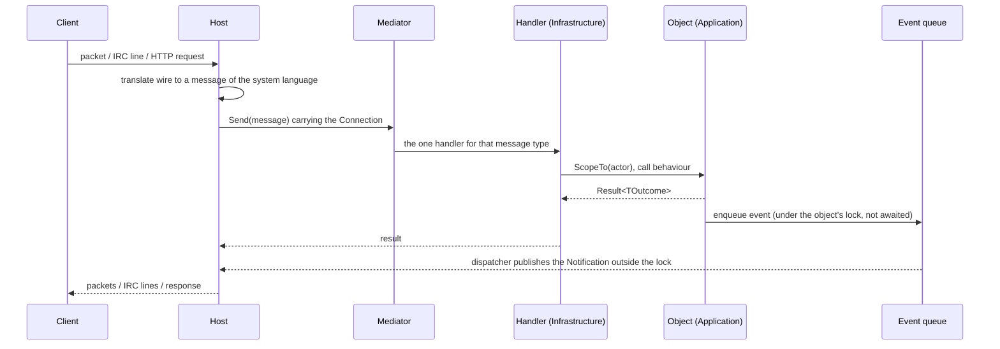

# Architecture

## Overview

Basil is a single deployable process: a modular monolith. It is cut twice. Horizontally, by layer: Domain is the system at
rest, Application is the running system and its contracts, Infrastructure implements the contracts. Vertically, by
module: each module owns one slice of the business end to end and may use only the modules below it in a fixed graph.
Around that core sit four kinds of project that do not hold business rules: Protocol (the translation language of the
wire), Hosts (translate and dispatch), Gateway (admission control) and the Server (the way to run it all).

> **Migration status.** This page describes the target architecture. The code is migrated phase by phase, and parts
> of the page are marked **(target)** where the code does not match yet. Handlers and object-free logic still sit in the Application projects (they move to
> Infrastructure), hosts still call `ScopeTo` themselves (they will send Mediator messages), the rate limiter and upload
> limits still sit in `Basil.Host.Shared` and the hosts (they move to `Basil.Gateway`), persistence still has
> write-behind pieces (being removed, see [`database.md`](database.md)), and `Application.Diagnostics`,
> `Application.Bot` and `Basil.Gateway` do not exist yet. Where this page and the code disagree, the code is the
> state and this page is the direction.

## Layers

| Layer | Is | Holds | Does not hold |
|---|---|---|---|
| Domain | the system at rest | durable models (what is stored) and the rules that stay true while the system is offline: validity of data, constants and enums of the rules, pure computation | runtime state, time, connections, I/O |
| Application | contracts plus the running system | runtime objects (`User`, `Connection`, `Room`, channels), registries, capabilities, Mediator messages, and the contracts of services, ports, repositories and storages | implementations, third-party libraries |
| Infrastructure | the implementations of those contracts | EF rows, handlers, service implementations, adapters, workers | contracts other layers depend on |

A type belongs to Domain only if it is stored or is a rule that stays true offline. A type that only means something while
the system runs (session state, presence, spectator frames, the state of a room in play) belongs to Application of the module
that owns it. A row that carries data to the database is not a Domain model; it is an Infrastructure row.

```text
Basil.Domain                     the system at rest                              -> (nothing)
Basil.Application.Common         shared contracts, Result<T>, events, Mediator    -> Domain, Mediator.Abstractions
Basil.Infrastructure.Common      shared database, files, event dispatcher         -> Application.Common, Domain
Basil.Application.<Module>       contracts and runtime objects of one module      -> Domain, Application.Common,
                                                                                     the Application projects it uses
Basil.Infrastructure.<Module>    implementations of that module's contracts       -> its own Application,
                                                                                     Infrastructure.Common
Basil.Infrastructure.Postgres    (target) Npgsql provider and PostgreSQL          -> Infrastructure.Common
                                 migrations; only the Server references it
Basil.Protocol.Stable / .Irc     the translation language of each wire            -> Domain / nothing
Basil.Gateway                    (target) admission control                       -> (nothing but the rate-limiting library)
Basil.Host.Shared                views and outcome-to-error mapping               -> Application projects
Basil.Host.Stable/.Irc/.Rest/.Cli  transports                                     -> Host.Shared, Protocol, Gateway, Application
Basil                            composition root -> everything
```

`tests/Architecture/` reads the project references and fails on an edge outside this graph, on a cycle, and on a host
that references another host.

## Modules

A module owns one slice of the business. The compiler enforces which module may use which:

```text
Authentication, Beatmaps, Content -> Common
Users        -> Authentication, Content
Anticheat    -> Users
Scores       -> Users, Beatmaps
Multiplayer  -> Users, Beatmaps, Content, Scores
Chat         -> Users, Multiplayer
Diagnostics  -> Users                      (target)
Servers      -> every module above
Bot          -> Anticheat, Beatmaps, Chat, Multiplayer, Scores, Servers, Users      (target: today Basil.Bot)
```

Each module is two projects. `Basil.Application.<Module>` holds only contracts and runtime objects.
`Basil.Infrastructure.<Module>` holds only implementations of those contracts and may use third-party libraries. A module
Infrastructure project never references another module's projects; foreign keys between module databases decide only the
order in which migrations are registered. Folder-by-folder detail is in [`../for-agents/application-design.md`](../for-agents/application-design.md).

### The service ladder

Application code is arranged in four levels. A level uses only the levels below it.

```text
Service      a system operation with a contract ("log in", "import a beatmapset", "report a flag")
Ports        capabilities whose implementation needs external computation or libraries (beatmapset reader, analyser)
Stores       Registry (live objects in RAM) | Repository (rows, awaited) | Storage (files)
Objects      runtime objects that own state, invariants and behaviour (User, Connection, Room, Channel)
```

* **Registry** keeps live objects in RAM and hands them out. It holds runtime state only.
* **Repository** awaits the database. Small records may be cached cache-aside; a large or streamed payload never is.
* **Storage** holds files and media (beatmapsets, replays, avatars). Images are served through ImageSharp.Web
  ([`assets.md`](assets.md)).

### How layers call each other

* A relation between different levels (a service using a store, a port or an object) is a direct call through
  dependency injection.
* A relation between peers (a service reacting to what another service did, a host asking a module to act) goes through
  **Mediator**: a Command or Query is sent, a Notification is published. Mediator itself belongs to Application (only
  `Mediator.Abstractions`); Infrastructure implements the handlers.
* A **Handler** is the Mediator listener for one message type. It is thin, one class per message type, `internal`, and it
  lives in `Infrastructure.<Module>/Handlers`. It scopes the object to the message's actor and calls its behaviour.
* A handler that translates a Notification to a wire (Notification to packets or lines) lives in the host that owns that
  wire (the IRC host's `Delivery/` folder is the model).

### Messages

A message is a Mediator **request**: a `record` in the owning module's Application project that implements
`IRequest<TResponse>` and carries the `Connection` of the caller as `Actor` (a login carries none, because it creates the
`Connection`). Mediator maps each request type to exactly one handler, so the host never names a handler.

* A command changes state and answers `Result<TOutcome>` (the outcome enum of the object it acts on); a query reads and
  answers a view or `null`. Both are requests; the name says which (`PostChatMessage`, `GetChannelMembers`).
* A message addresses things by identity, not by a transport's spelling: chat uses a `ChatTarget` (a general channel's
  name, a room's id, a user's id), never an IRC `#name` or an osu! alias. The host translates its own spelling.
* A message is a public type of Application; its handler is `internal` in Infrastructure and the `Basil` project is made
  a friend of that assembly, because the one `AddMediator` call there generates the dispatch.
* Pipeline behaviors apply to requests only; a Notification never passes through them.
* Notifications are published by the event dispatcher, one handler after another; a handler that throws is logged and
  the others still run (see below).

## Events and locks

An object publishes an event while it holds its own lock (a `Room` changes state and announces it in one transition).
Notifications are therefore **never awaited under a lock**: the object enqueues the event on the shared event queue
(`EventQueue`, Application.Common) and returns at once, and a dispatcher in Infrastructure.Common (`EventDispatcher`)
calls the Mediator handlers outside the lock, in order. No code calls `await mediator.Publish(...)` at the place where it
emits. The queue has a ceiling and refuses to grow without bound (**target**, with the gateway's load policies).



## The edge of the system

### Protocol: the translation language

`Basil.Protocol.Stable` and `Basil.Protocol.Irc` are the vocabulary and grammar of each wire: the osu! binary packets, IRC
lines, the delimited strings of the web endpoints, and the client's own encoding (the score submission cipher). They are
C# models of primitives. They do not validate, give no business meaning and coordinate nothing. A host uses Protocol to
read and write its wire, checks what the client sent (`WireMap.Known`, `WireMap.Mods`) and builds a message of the
system's language. Only the transports that speak a protocol reference it; Application and Infrastructure never do. If a
wire format changes, only Protocol changes. `Protocol.Stable` references Domain because the game enums carry the client's
numbering; `Protocol.Irc` references nothing.

### Hosts: translate and dispatch

`Basil.Host.Stable`, `.Irc`, `.Rest` and `.Cli` translate. Inbound, a host receives a packet, line or request, translates it
with Protocol into a strongly typed message of the system language (not flattened), and sends it through Mediator to a
service. Outbound, a host listens to Notifications and translates them to its wire. A host holds no business rule, no
permission rule and no state. **(target)** A host never calls `ScopeTo`, never references Infrastructure, and never
references another host; today hosts still call `ScopeTo` directly and the migration moves that into handlers module by
module. `Basil.Host.Shared` holds the views and the table that turns an outcome into an API error code; it holds no
ASP.NET types.

### How the host knows whose request it is

* **Which handler?** The host does not choose a handler. It chooses a **message type** from the wire (an HTTP route, a
  packet id, an IRC command) and sends it. Mediator maps a message type to exactly one handler at compile time. The host
  knows only the message record in `Application.<Module>`, not the handler or the module that implements it.
* **Whose request?** Every transport session is bound to a `Connection`, an object of the Users module. Logging in is a
  Command with no actor and returns the `Connection`. On Rest the token is resolved by a Query to a `Connection` that is
  attached to the request; on Stable the polling request carries the `osu-token`; on IRC the socket keeps the
  `Connection` after PASS and NICK. Every later message carries the `Connection` as its actor, and the handler
  calls `object.ScopeTo(message.Actor)`; the capability computes effective permissions and checks them with `Require`.
* **Unforgeable.** Only the Users module creates a `Connection` (its constructor is `internal`), so a host cannot build one.
  A bad token resolves to nothing and the host answers 401 before any business message is built.

### Gateway: admission control

`Basil.Gateway` **(target)** is a leaf project that answers one question about each incoming request, `Allow` or `Deny`
(with a reason code and a retry delay), from facts that exist before business logic: size, rate, concurrency and load. It
translates nothing, dispatches nothing and knows no business concept; it references no user type and has no bans or
restrictions. The host enforces the answer in its protocol. The design is in [`gateway.md`](gateway.md).

### Server: the way to run it

The project `Basil` is the composition root: it builds dependency injection, binds
configuration, chooses Kestrel, ports, TLS and the database provider, wires hosts, gateway and modules, owns logging and
the lifecycle (start, stop, restart) and `Program.cs`. It calls `AddMediator` once so the generated code finds every
handler. It sees the whole system in order to run it, but means nothing to the hosts or the gateway: none of them knows it
exists. It contains no business object, no recovery logic and no admission policy.

## Dependency rules

* Domain and Protocol.Irc reference nothing; Protocol.Stable references Domain only.
* Application.Common references Domain; Infrastructure.Common references Application.Common and Domain.
* A module Application project references Domain, Application.Common and the Application projects of the modules it uses.
  A module Infrastructure project references its own Application project, Infrastructure.Common and Application.Common,
  never another module.
* Application never creates a database connection, a file stream or an Infrastructure type; it declares a contract and the
  outer project implements it.
* Hosts reference `Host.Shared`, Protocol, Gateway and Application projects; they never reference Infrastructure or another
  host. Rest and Cli never reference `Protocol.Stable`. **(target)** for the Infrastructure part.
* Only the Server references everything.
* Options belong to the project that defines them: that project binds them (`Add<Module>...(IConfiguration)`). **(target)**;
  today the composition root binds all configuration and hands `IOptions<T>` over.

## Object capabilities

Runtime state has owners: a room owns its slots and rounds; Chat keeps a room channel per open room, a private-message
channel per online user and a spectator channel per watched game client. Behaviour stays with the state it changes.

The caller gets the runtime object and then a capability (`Scoped*`, called Cap in the design notes) for its connection:

```text
channel.ScopeTo(actor).Join();
room.ScopeTo(actor).Members.JoinAsync(password);
```

A capability is a `readonly struct` valid for one request. It snapshots the actor's effective permissions once, offers
forwarding getters for the owner's parts, and calls the owner's `internal` raw mutators. Behaviours that can be refused return
`Result<TOutcome>`. A capability is never stored in a field or property (an architecture test enforces this). System work
with no caller (startup, event handlers reacting for the server, announcements) calls the object directly.

## Sessions and connections

A session is the persisted record of a sign-in; a connection is the live socket or request. A session stays valid while
its connection is idle or closed; the connection leaves memory after the idle window and the next request verifies the
token against the database. Connection types are Stable, StableTourney (the osu!tourney client and observers), Irc and Api.
BasilBot is a module bound to user id 1 that holds exactly one Stable and one Irc connection and has no connection type
of its own; see [`../for-agents/identity-permissions.md`](../for-agents/identity-permissions.md), which also owns the
per-user session limits.

## Streaming

Data reaches its consumer directly. A database read is bounded, loaded, the connection released, and only then sent. Every
upload is spooled to a temporary file, validated, then moved atomically into place. Application code does not buffer a
payload in a `MemoryStream`. The mandatory rule is in [`../../AGENTS.md`](../../AGENTS.md).

## Live updates

Every live HTTP route is under `Basil.Host.Rest` and uses one hub. A stream belongs to a root (a player, a room, a match,
the server); the hub bundles events once a second, serializes the bundle once and hands the same bytes to every stream of
that root. The first event is a snapshot. See [`sse.md`](sse.md).

## Adding features

* **An osu! (stable) packet or IRC command:** add a message record in the owning module's Application project, a handler in
  its Infrastructure project, and the host's translation from the wire to the message. Add a missing rule to the object,
  not to the host.
* **A reaction:** a handler for the Notification in the owning module's `Infrastructure.<Module>/Handlers`, or in the
  host that owns the wire for a Notification-to-wire handler.
* **Persisted state:** add a repository contract in the module's Application `Persistence/` and implement it in the
  module's Infrastructure project. No SQL text anywhere.
* **An HTTP endpoint:** add a route in `Basil.Host.Rest` that translates and sends, declare its admission policy in the
  gateway, and let the generated OpenAPI describe the contract.

## Invariants

* Dependencies point down; `tests/Architecture/` enforces the module and host graphs.
* Domain is dependency-free and holds nothing that exists only while the system runs.
* The acted-on object stores the relation and emits the event.
* A notification is never awaited under a lock; objects enqueue, a dispatcher publishes.
* A capability lives for one request.
* Only Users creates a `Connection`; every business message carries one.
* Every entry point declares an admission policy **(target)**.
* Performance points are not part of gameplay.
* User-visible reply strings are centralized in the production type that owns them.

## Related code

* `src/Domain/` — the system at rest.
* `src/Application/Common/`, `src/Infrastructure/Common/` — shared values, events, `Scoped.cs`, dispatcher (`Workers/EventDispatcher.cs`).
* `src/Application/<Module>/`, `src/Infrastructure/<Module>/` — module contracts, objects and implementations.
* `src/Protocol/Stable/`, `src/Protocol/Irc/` — the translation language of each wire.
* `src/Hosts/Shared/`, `src/Hosts/{Stable,Irc,Rest,Cli}/` — views and the transports.
* `src/Basil/` — the composition root.
* `tests/Architecture/` — `ModuleGraphTests`, `HostGraphTests`, `CompositionTests`, `ScopedLifetimeTests`.

## Where to go from here

| Topic | Documentation |
|---|---|
| Admission control | [`gateway.md`](gateway.md) |
| Diagnostics | [`diagnostics.md`](diagnostics.md) |
| osu! (stable) packet dispatch | [`osu-stable.md`](osu-stable.md) |
| Multiplayer and match state | [`multiplayer.md`](multiplayer.md) |
| Chat, sessions and connections | [`chat.md`](chat.md), [`irc.md`](irc.md) |
| HTTP live updates | [`sse.md`](sse.md) |
| API response envelope | [`response-envelope.md`](response-envelope.md) |
| Database and persistence | [`database.md`](database.md) |
| Beatmap ingestion | [`beatmap-ingestion.md`](beatmap-ingestion.md) |
| Logging | [`logging.md`](logging.md) |
| Testing | [`testing.md`](testing.md) |
| Configuration | [`../for-technicians/configuration.md`](../for-technicians/configuration.md) |
| Project scope | [`working-scopes.md`](working-scopes.md) |
