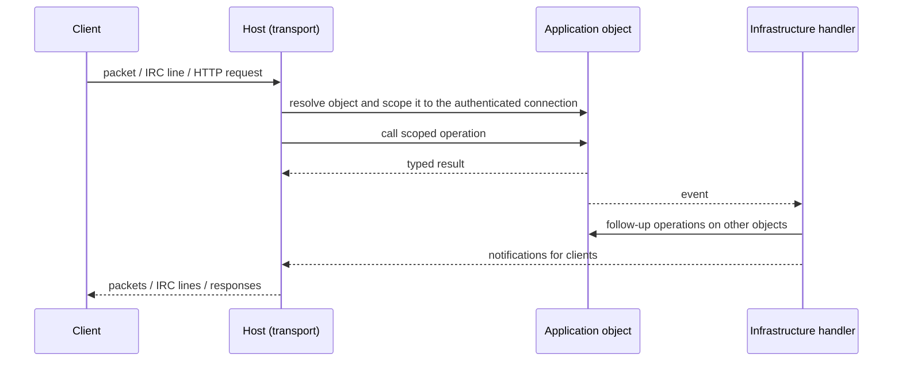

# Architecture

## Overview

Basil is a single deployable process with a strict dependency direction. Domain defines persistent business values;
Application objects own runtime state and behaviour and call small object-free services for logic that needs no live
object; Infrastructure implements persistence and other capabilities; the hosts translate client protocols into
Application operations. Nothing in a transport decides a business rule.

```text
Basil.Domain                              business values                          -> (nothing)
Basil.Application.Common                  shared values and event contracts/queue   -> Domain, external packages
Basil.Infrastructure.Common               database, memory, files, dispatcher       -> Application.Common, Domain
Basil.Application.<Module>                ports, capabilities and runtime objects   -> Domain, Application.Common,
                                                                                       the Application projects it uses
Basil.Infrastructure.<Module>             implementations, DbContext, migrations    -> its own Application,
                                                                                       Infrastructure.Common
Basil.Protocol.Bancho / .Irc              wire formats                             -> external libraries only
Basil.Host.Shared                         client views and outcome-to-error mapping -> Application projects
Basil.Host.Bancho / .Irc / .Rest / .Cli   transports                               -> Host.Shared, Application, Protocol
Basil.Host                               composition root, configuration,         -> every project
                                         logging, shutdown
Basil.Bot                                BasilBot commands and announcements       -> the Application projects it uses
```

`Basil.Host` is the only composition root. It calls `AddBasil()` and the one `AddMediator()` so the source generator
finds every handler, binds configuration, owns logging and shutdown and registers the transports. It contains no
business object of its own: starting the server, restoring state and creating directories belong to Application and
Infrastructure.

## Projects and responsibilities

### `Basil.Domain`

Business models that outlive a run of the server (`User`, `Session`, `Room`, `Round`, `Score`, `Beatmap`, chat channel
models, …), each guarding its own validity. It holds no runtime-only state and no events and references no other Basil
project.

### `Basil.Protocol.Bancho` and `Basil.Protocol.Irc`

The wire formats. They turn client bytes into C# models of primitives and back, including the score submission cipher,
and give no business meaning. They reference no other Basil project, so they can be tested without a server. Only the
transport that speaks the protocol references it: Bancho references `Protocol.Bancho`, Irc references `Protocol.Irc`,
and Rest and Cli reference neither.

### Module projects

A module (Auth, Beatmaps, Chat, Content, Multiplayer, Scores, Servers, Users, Anticheat) owns one slice of the business
end to end. Splitting by module lets the compiler enforce which module may use which; `tests/Architecture/` fails on an
edge outside this graph:

```text
Auth        -> Common
Beatmaps    -> Common
Content     -> Common
Users       -> Common, Auth, Content
Anticheat   -> Users
Scores      -> Users, Beatmaps
Multiplayer -> Users, Beatmaps, Content, Scores
Chat        -> Users, Multiplayer
Servers     -> every module above
```

`Basil.Application.<Module>` holds `Persistence/` (repository and storage ports, query records), `Capabilities/` (ports
whose implementation needs external libraries, public; and object-free logic, internal), and `Runtime/` (live objects,
registries, scopes, contexts, feature events and their coordination). Behaviour belongs to the object that owns the
state; a service takes and returns records, never a live object, and never publishes an event.
`Basil.Infrastructure.<Module>` implements its own Application project's ports with PostgreSQL, files, rulesets,
ImageSharp and background work. A module Infrastructure project never references another module; foreign keys between
the module databases decide migration order.

Handlers stay `internal`; a module grants `InternalsVisibleTo("Basil.Host")` (the generated Mediator code names them)
and its own test project, nothing else.

### Common projects

`Basil.Application.Common` owns `Result<T>`, `Scoped<T>`, paging and search syntax, and the shared event contract,
publisher and queue. `Basil.Infrastructure.Common` owns the shared database and file implementations, the common
migration and the event dispatcher.

### Transports

| Project | Speaks | Notes |
|---|---|---|
| `Basil.Host.Bancho` | osu! stable: Bancho packets, polling, legacy web endpoints | owns the `c.`/`osu.` routing |
| `Basil.Host.Irc` | IRC on plain TCP | contract in [`irc.md`](irc.md) |
| `Basil.Host.Rest` | HTTP API on `api.`, plus images on `a.`/`assets.` | envelope, SSE, diagnostics, OpenAPI |
| `Basil.Host.Cli` | the terminal dashboard and its command box | three display modes, control socket |

Every transport references `Basil.Host.Shared` and never another transport. `Basil.Host.Shared` holds the view records
both Rest and Cli return and the table that turns an Application outcome into an API error code. A transport takes the
actor from the connection that opened the request or socket and works through scopes (`x.ScopeTo(connection)`); it
holds no duplicated permission or state rule. The tests in `tests/Architecture/HostGraphTests.cs` enforce these edges,
with a positive control for each rule.

### Configuration

Configuration is bound only in `Basil.Host`. A transport receives `IOptions<T>` of an options type it owns. Policy that
can change at runtime lives in the database (`ServerSettings`, owned by Content.Application) and is read on each use;
deployment settings live in `Configurations/appsettings*.json`. See [`configuration.md`](../for-technicians/configuration.md).

## Dependency rule

* Domain and the protocols reference nothing.
* Application.Common references Domain; Infrastructure.Common references Application.Common and Domain.
* Every module Application project references Domain, Application.Common and the Application projects of the modules it
  uses; a module Infrastructure project references its own Application project and Infrastructure.Common, never
  another module.
* Transports reference `Basil.Host.Shared`, their own Application projects and their Protocol project. Only
  `Basil.Host` references the transports.
* Application never creates a database connection, file stream or Infrastructure type. It declares a port; the outer
  project implements it.

## Object scopes

Runtime state has owners: a room owns its slots and rounds; Chat keeps a room channel per open room, a private-message
channel per online user and a spectator channel per watched game client. Keeping behaviour with that state prevents a
central service from becoming a procedural actor that must know every rule.

The caller first gets the runtime object, then creates a short-lived view for its connection:

```text
channel.ScopeTo(by).Join();
room.ScopeTo(by).Members.JoinAsync(password);
```

The scope captures the caller's effective permissions and role on that object; it must not be kept for later work. It
checks authority and restrictions, preserves the object's invariants, mutates its state and emits events. Parts are
reached through the owner (`room.ScopeTo(by).Slots`, `.Rounds`, `.Settings`), never through a service that takes the
room as a parameter, and no operation accepts a caller's permission mask as plumbing through lower layers.

System work with no caller (startup, public reads, event handlers, BasilBot announcements) calls the object directly.
Actions with authority use a scope, including commands typed in chat: the command uses the typist's connection while
BasilBot only sends the reply.

## Events

Events form a category tree so a consumer can subscribe to a whole category:

```text
Event
├── UserEvent         connections, restrictions, permissions, notifications, spectator frames
├── ChannelEvent      channel lifecycle, membership, messages
├── LobbyEvent        room opened, closed, closing announced
├── RoomEvent         settings, slots, membership, authority, rounds
├── BeatmapsetEvent   imported, deleted
├── ScoreEvent        submitted
└── AnticheatEvent    player flagged
```

Events carry identities as references and changeable values as values captured when the event was emitted, never a
live slot. One shared queue (`EventQueue`, Application.Common), run by `EventDispatcher` in Infrastructure.Common,
delivers every event in order to its handlers. Application publishes events and handles those of its own module;
Infrastructure only ships them; a transport reacts to events by delivering them to its clients.



## Sessions and connections

A session is the persisted record of a sign-in (`ConnectionType`: Osu, Tourney, Irc, Api, Bot); a connection is the
live socket or request in memory. A session stays valid while its connection is idle or closed; the connection leaves
memory after the idle window (300 seconds) and the next request verifies the token against the database and opens a new
connection. Api tokens and IRC keys are stored as hashes; osu! signs in every time. BasilBot has a `Bot` session and
connection that no client can present.

## Live updates

Every live HTTP route is under `Basil.Host.Rest` and uses the same hub. A stream belongs to a root (a player, a room, a
match, the server); the root collects events and once a second the hub bundles them, serializes the bundle once and
hands the same bytes to every stream of that root. The first event is always a snapshot. Data is therefore up to about
one second old. See [`sse.md`](sse.md).

## Adding features

* **A Bancho packet or IRC command:** decode in the transport, call the Application operation of the acted-on object,
  translate the typed result. Add a missing rule to the object, not to the transport.
* **A reaction:** register a handler for the event category in the owning module's Runtime folder or in `Basil.Bot`,
  then call the owning object's operation.
* **Persisted state:** add a port in the module's Application `Persistence/`, implement it in the module's
  Infrastructure project and register it. Keep SQL out of Application.
* **An HTTP endpoint:** add a route in `Basil.Host.Rest`, delegate to Application and let the generated OpenAPI describe
  the contract. Do not write a second hand-written API reference.

## Invariants

* Dependencies point down; the tests in `tests/Architecture/` enforce the module and host graphs.
* Domain and protocols remain dependency-free.
* Runtime objects are separate from persisted state; Domain holds no runtime state or events.
* The acted-on object stores the relation and emits the event.
* Permission-dependent room operations use `room.ScopeTo(by)`; a read-modify-write transition is one synchronous method
  of `Room` holding the room lock across the complete transition.
* Privilege checks require every bit of the requirement, and use effective permissions.
* A shared channel is named `#name`; a private-message channel carries its owner's name without `#`.
* User-visible reply strings are centralized in the production type that owns them.
* Performance points are not part of gameplay.

## Related code

* `src/Application/Common/`, `src/Infrastructure/Common/` — shared values, events, storage, dispatcher.
* `src/Application/<Module>/`, `src/Infrastructure/<Module>/` — module ports, objects and implementations.
* `src/Hosts/Host/` — composition root, configuration, logging, lifetime, restart.
* `src/Hosts/Shared/` — views and the outcome-to-error table shared by Rest and Cli.
* `src/Hosts/{Bancho,Irc,Rest,Cli}/` — the transports.
* `src/Bot/` — BasilBot commands, announcements and reply catalogue.

## Where to go from here

| Topic | Documentation |
|---|---|
| Bancho packet dispatch | [`bancho.md`](bancho.md) |
| Multiplayer and match state | [`multiplayer.md`](multiplayer.md) |
| Chat, sessions and connections | [`chat.md`](chat.md), [`irc.md`](irc.md) |
| HTTP live updates | [`sse.md`](sse.md) |
| API response envelope | [`response-envelope.md`](response-envelope.md) |
| Database and persistence | [`database.md`](database.md) |
| Beatmap ingestion | [`beatmap-ingestion.md`](beatmap-ingestion.md) |
| Logging | [`logging.md`](logging.md) |
| Testing | [`testing.md`](testing.md) |
| Configuration | [`../for-technicians/configuration.md`](../for-technicians/configuration.md) |
| Project scope | [`working-scopes.md`](working-scopes.md) |
