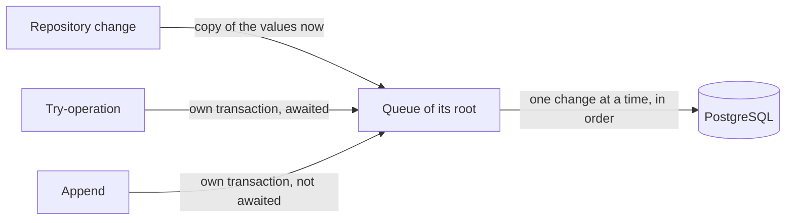

# Database

## Overview

Basil keeps its records in PostgreSQL, but the database is not where the server works. **Memory is the truth;
the database keeps a copy of what was done.** Every change is applied to the live object in memory first and its
copy is queued for the database; no operation waits for the database unless its result comes from the database.

This document explains why the storage works this way, what is stored, and how writes, reads and migrations work.
Files (beatmapsets, replays, avatars, menu images, screenshots, FAQs) are not in the database; see
[`assets.md`](assets.md) and [`beatmap-ingestion.md`](beatmap-ingestion.md).

## Why memory first

Basil runs one server process for one deployment, and every request it answers concerns objects that are already
alive: the user who is online, the room being played, the beatmap selected in it. Asking the database for them on
every request would add a network round trip to every packet and make a slow or lost database stall the game.

So:

* a player can log in, chat and play while the database is unreachable, as long as nothing they do needs a new
  identity or a unique-value check;
* the database never decides what the server sees: a row that is missing means "not loaded yet", never "does not
  exist";
* one database belongs to one Basil process; nothing else writes it behind the server's back.

PostgreSQL replaced the earlier SQLite file to scale and to write in parallel: SQLite allows one writer at a time,
PostgreSQL many concurrent transactions. The trade-off is that Basil is no longer self-contained: a deployment now
needs a database server and its credentials. The write path was measured before it was fixed; see
[`plans/evidence/postgresql-direct-writes-20261008`](../../plans/evidence/postgresql-direct-writes-20261008/results.md).

## What is stored

| Group        | Tables                                                                      | Notes                                                                 |
|--------------|-----------------------------------------------------------------------------|-----------------------------------------------------------------------|
| Accounts     | `users`, `credentials`, `restrictions`, `relationships`, `logins`           | `logins` is append-only history                                       |
| Server       | `settings` (one row per setting), `channels`, `menu_banners`               | resident: loaded at startup, never released                           |
| Beatmaps     | `beatmapsets`, `beatmaps`, sequences `local_beatmapset_ids`, `local_beatmap_ids` | mirror the stored beatmapset files; local ids start at 1 000 000 000 |
| Multiplayer  | `matches`, `rounds`, `match_events`, `round_scores`                         | `match_events` is append-only history                                 |
| Scores       | `scores`, `user_stats`                                                      | a score belongs to its player                                         |

Conventions: snake_case names, every time is `timestamptz` in UTC (the presentation converts it to local time), MD5
values are lowercase hex text, an asset is stored as the canonical text of its `AssetReference`.

The tournament tables separate the match from what changes per round:

```text
matches ──┬── match_events        lifecycle history (creation, closure, referees, …)
          └── rounds (match_id, number)
                 └── round_scores ──► scores
```

Beatmap, mode, mods, team type and win condition can change every round, so they live on `rounds`, and a round
refers to its beatmap by content hash rather than by copying its names. Which round a score was played in is a
relation of its own (`round_scores`) so the score stays a record of its player. What was decided for a round (who won,
by how much, the ranking of the scores) is stored as JSON in `rounds.result` when it is decided.

## Invariants

* **Memory first.** Everything asks memory first and reads the database only on a miss, to load into memory. A
  change is applied to the live instance and its copy is queued.
* **One live instance per identity.** Every `GetAsync`, `GetByYAsync` and `ListAsync` of a repository returns the same
  instance for the same identity while anything holds it or a change of it is not stored yet.
* **Only a try-operation waits.** An operation whose outcome comes from the database (an identity the store assigns,
  a unique value) is a try-operation and waits; everything else returns at once.
* **Unique values.** When memory holds a record with the value, the change is rejected at once; otherwise the insert
  runs as a try-operation and a unique violation means the value is taken (`AlreadyExistsException`, or `false` for
  a rename). The existing record is not loaded.
* **Parents before children.** A child refers to a parent of another root only once the parent is committed; such a
  parent is created by an awaited try-operation.
* **Appends are stored exactly once.** Logins and match events carry no business id; the database assigns it.
* **Scores attach to the round they were played in.** A round is identified by its match and its number; the live
  room numbers the round when it starts, so the number is known before any score arrives. The room's latest round is
  replaced only when the next round starts, so a score that arrives after the round-ending packet still resolves to
  the round it was played in, and only when it was played on that round's beatmap. See
  [`multiplayer.md`](multiplayer.md).
* **Beatmaps are referenced by content hash**, which survives a row being replaced; ids are for lookups.
* **Deleting a beatmapset deletes its beatmaps**, enforced by the foreign key (`on delete cascade`).
* **`user_stats` is not derived.** Basil has no singleplayer ranking, so the per-mode totals are kept as they are and
  are not rebuilt from `scores`.

## How it works

### Memory

Each repository keeps its live instances itself:

* **Resident data**, the records every client uses (server settings, general channels, menu banners), is loaded at
  startup and never released.
* **On-demand data** is held by identity for as long as something holds it (a session its user, a room its match) or
  a change of it is not stored yet; there is no expiry.
* **Owned lists** (a user's restrictions and relationships, a set's beatmaps, a match's rounds and events, a round's
  scores) live as long as their owner instance: loaded whole the first time they are needed, then changed item by
  item. A change made while the list loads, or not committed yet, is applied to the loaded list too.

### Writes



* `DatabaseWriter` keeps one queue per **root**: `Root.User`, `Root.Match`, `Root.Beatmapset`, `Root.Server`. Writes
  of one root are sent in order, one change at a time; a copy not sent yet is replaced by a newer copy of the same
  identity. At most `Basil:Database:WriteConnections` connections (8 by default) write at once.
* A **copy** (`CreateOrUpdateAsync`, `DeleteAsync`) carries the values as they were when queued and returns at once.
* A **try-operation** runs in a transaction of its own after the earlier writes of its root; its cancellation token
  counts only while it waits for its turn. Its transaction also stores a ticket row (`write_tickets`); a commit whose outcome was lost with the connection is
  settled by asking whether the ticket exists, so the write is neither lost nor run twice. Old tickets are removed.
* An **append** runs the same way as a try-operation but nobody waits for it; a refusal is logged.
* No write is grouped with unrelated writes. A business operation that must store several rows together gets one
  try-operation of its own.

### Errors

Only environment errors are retried: lost connection, timeout, server shutting down, read-only after a failover,
deadlock, authentication, permissions. They are retried before any later write of the same root, with a back-off up
to 5 seconds. Any other error fails that write alone: a try-operation throws it to its caller, a copy or an append is
logged as an error. On shutdown the server waits for the queues to drain and logs how many writes were not stored.

### Reads

A read runs on a context of its own, on a pooled connection, and sees only what is committed. A listing asks the database which rows
match and returns the live instance of each; a row whose deletion is still queued never comes back into memory.

### Migrations

Each module owns its schema through a dedicated Entity Framework context and migration history. This keeps a module's
tables and schema changes together while preserving foreign keys between modules; a referencing context maps the
principal table without taking ownership of its migration.

At startup `DatabaseMigrator` applies the module migrations in foreign-key order: Common, Users, Auth, Beatmaps, Content,
Scores, Multiplayer, then Chat. Each records its migrations in `__ef_migrations_<module>`. `write_tickets` belongs to
Common, the beatmap id sequences belong to Beatmaps, and the seeded channels belong to Chat. Persistence holds no SQL
text: schema changes are Entity Framework migrations and reads and writes use LINQ and row objects.

The module `InitialCreate` migrations replace the former single `InitialCreate`. This is safe only because no database
has applied that old migration; an already-migrated database would need a separate one-time adoption before using the
new histories.

## Related code

* `src/Infrastructure/Persistence/Common/Database/` — `DatabaseWriter`, `DatabaseReader`, `DatabaseMigrator`
* `src/Infrastructure/Persistence/Common/Writing/` — `Root`, `WriteCommand`, environment errors
* `src/Infrastructure/Persistence/Memory/` — `MemoryRepository`, `IdentityMap`, `WeakIndex`, `OwnedLists`
* `src/Infrastructure/Persistence/<Module>/`, the `XxxRow` types and `Migrations/<Module>/` — the module schemas
* `src/Infrastructure/Persistence/StorageStartup.cs` — migration and resident loading at startup

## See also

* [`architecture.md`](architecture.md) — layers and where repositories live
* [`multiplayer.md`](multiplayer.md) — rounds and score attachment
* [`assets.md`](assets.md) — files and asset references
* [`configuration.md`](../for-technicians/configuration.md) — `Basil:Database` settings
