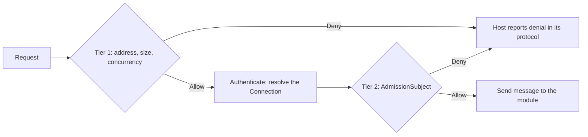

# Gateway

## Overview

The gateway is the admission control of Basil: for every request that wants to enter the system it answers `Allow` or
`Deny`, using only facts that exist before any business logic runs. A request that is oversized, too frequent, too
concurrent or arriving while the server is overloaded never reaches a module.

> **Migration status.** The rate limiter, the login-attempt guard and the second tier (`Admission`, `AdmissionSubject`,
> `GatewayLimits`) live in `Basil.Gateway`, with the load policies below (bulkhead, shedding, health). The Rest, Stable and
> IRC hosts call `Admit` before they handle a request and `Release` when it ends; `Basil.Host.Shared` maps a `Connection` to
> an `AdmissionSubject` and decides how a denial is reported. Every subject is `Standard` for now: no rule yet grants the
> `Elevated` allowance. The Stable and Rest hosts still have their own upload limit (they depend on ASP.NET Core
> and the runtime settings, so they cannot move as they are).

## Why

Limits written inside each host are repeated, drift apart and are easy to forget on a new route. Putting them in one
place makes the policy visible, testable and the same for every protocol. The gateway is kept apart from the business on
purpose: a ban or a restriction is a business fact, decided at login and by capabilities (see
[`../for-agents/identity-permissions.md`](../for-agents/identity-permissions.md)); the gateway only protects the process.

## What

* **A leaf project.** `Basil.Gateway` references nothing of Basil, only the rate-limiting library of the platform. The four
  hosts reference it; it references no user type.
* **Allow or Deny only.** A decision carries a reason code and, when useful, a retry delay. It does not translate, route or
  dispatch.
* **The host enforces.** The host reports a denial in its own protocol. On Rest and on the web and game endpoints of
  Stable a denial is HTTP 429 when the subject is over its allowance and 503 when the server is shedding or the kind of
  work is full, both with `Retry-After`; Rest answers in the response envelope (`rateLimited` or `busy`). `/health` is
  never refused. On IRC a line over the allowance is answered with a `NOTICE` and the connection is closed; a line refused
  for load gets a `NOTICE` and is dropped. A signed-in caller is counted as a user, whatever the number of its connections;
  a caller that is not signed in is counted by its address (IRC: by its socket).
* **No admission facts from the business.** There is no interface through which the gateway asks the business whether a user
  is banned or restricted.

### Policies

| Policy | Limits | Keyed by |
|---|---|---|
| Size | bytes of a body or upload, pixels of an image, length of a line | the entry point |
| Rate | requests or attempts per window | client address (tier 1), user or API key (tier 2) |
| Concurrency | requests in flight | the kind of work (a bulkhead), the user |
| Load | refuse or shed work while the server is overloaded | the priority of the work |

### Two tiers

1. **Before authentication.** Raw facts only: client address, size, concurrency. This tier guards login and token lookup,
   where nothing is known about the caller. Failed login attempts keep their own counter, because a limiter that is
   consumed by time does not give a permit back on success.
2. **After authentication.** Per user. The host turns the `Connection` into an opaque `AdmissionSubject` (a key and a tier)
   that the gateway defines; the mapping lives in `Basil.Host.Shared`. A signed-in user gets a higher allowance, and
   all of a user's connections share one key. The tier is recomputed for each request from effective permissions and is not
   stored. The gateway never sees a Users type.

### Load policies

Taken from well-known cloud design patterns, limited to what this single process needs:

* **Throttling** caps the rate at which a client or kind of work is served.
* **Bulkhead** bounds concurrency per kind of work so that one slow kind (a beatmapset import, a leaderboard query) cannot
  use up every worker. An entry point declares its kind with `[AdmissionPolicy(Class = WorkClass.Listing)]`; the default
  is `Interactive`. A saturated class is denied (`ClassSaturated`) without touching the others, and every allowed request
  must be matched by one `Admission.Release(class)` when it ends. A route declares its class with
  `AdmissionPolicyAttribute` (the most specific declaration wins): list and search routes are `Listing`, uploads are
  `Upload`, `/live` streams are `Live`; everything else, packets and IRC lines included, is `Interactive`.
* **Priority shedding** under overload drops the least valuable work first. The decision is a pure function of the
  `LoadSignal` and the class (`GatewayLimits.Sheds`).
* **Health** is derived from the same signal (`Admission.Health`) and read by `/health`, which answers `healthy`,
  `degraded` or `shedding`. It does not change the status code, so a probe does not restart a busy server.
* **Queue-based load leveling** is used only for work that can be derived again (rebuilding a derived file, a re-scan).
  Never for a request whose answer the client waits for or whose loss would lose data.

| Class | Work | Concurrency (default) | Shed from load |
|---|---|---|---|
| `Listing` | rankings, searches, listings | 32 | 0.70 (first) |
| `Upload` | replays, screenshots, avatars, beatmapsets | 8 | 0.90 |
| `Interactive` | gameplay, chat, rooms, accounts | 256 | 0.90 |
| `Live` | SSE streams | 1024 | 0.90 |

Health is `Healthy` below 0.50, `Degraded` from 0.50 and `Shedding` from 0.70. Every threshold and cap is a server setting
stored in the database (`rateLimits.admission`, changed through `PATCH /v1/settings/rateLimits` or the console); the
composition root hands `Admission` a snapshot of it from memory, so a change applies to the next request without a restart.
The Gateway itself knows only `GatewayLimits`. A value must be positive, and the loads ordered
0 < degraded < shed < hard shed <= 1. No load source feeds `LoadSignal` yet, so `/health`
reports `healthy` until one exists.

#### Audit of the queues for rebuildable work

No queue was added. The background workers are `BeatmapsetStorageWatcher` (rebuildable: re-scans the files),
`EmptyRoomCloser`, `IdleConnectionSweeper`, `SessionRetentionSweeper`, `DiagnosticsSampler` (periodic, nothing to level) and
the `EventDispatcher`. The other channels (`CommandWorker` of BasilBot, `IrcSession`, `SseHub`, `DiagnosticsFeed`) carry a
single connection's or stream's live traffic, which a client is waiting for, so they are not load-leveling candidates.

## How

Policies read an in-memory snapshot of their configuration, never the database on each request. The factors per tier are
runtime-configurable.

## Invariants

* The gateway is a leaf; it references no user, room or other business type.
* Every entry point (an HTTP route, a packet type, an IRC command) declares an admission policy. The rule is
  `AdmissionPolicyTests`: an entry point declares it by carrying `AdmissionPolicyAttribute` in its metadata, and a
  positive control proves an entry point without it is detected. The test enumerates every route of the Rest host and of
  the two osu! routers (as mapped endpoints), every packet type of the osu! client (the whole `ClientPacketType` enum) and
  every IRC command (the commands of the IRC reference). The attribute only declares; a policy that applies no limit
  still counts as declared. The images served on `a.`/`assets.` are middleware, not routes, and are not enumerated.
* A denial is decided before business logic runs, and the refusal is the same whether or not the target exists.
* Bans and restrictions are not gateway concerns.

## Related code

* [`RateLimiter.cs`](../../src/Gateway/RateLimiter.cs) and [`LoginAttemptGuard.cs`](../../src/Gateway/LoginAttemptGuard.cs) — the limiter and login guard.
* [`Admission.cs`](../../src/Gateway/Admission.cs) and [`GatewayLimits.cs`](../../src/Gateway/GatewayLimits.cs) — tier 2 and its swappable limits snapshot.
* [`UploadLimit.cs`](../../src/Hosts/Rest/Http/UploadLimit.cs) and [`UploadLimit.cs`](../../src/Hosts/Stable/Support/UploadLimit.cs) — the two upload limits. They stay in the hosts: they differ and depend on ASP.NET and the stored settings, so they do not move to the gateway.

## See also

* [`architecture.md`](architecture.md): where the gateway sits
* [`diagnostics.md`](diagnostics.md): rejected requests are counted there
