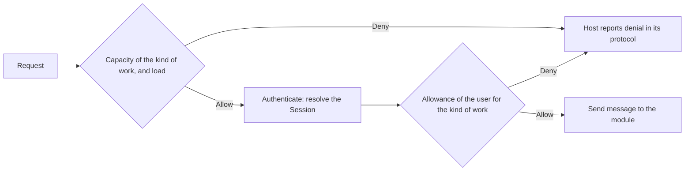

# Gateway

## Overview

The gateway is the admission control of Basil: for every request that wants to enter the system it answers `Allow` or
`Deny`, using only facts that exist before any business logic runs. A request that is too frequent, too concurrent
or arriving while the server is overloaded never reaches a module.

The rate limiter (`System.Threading.RateLimiting`, one registration), the login-attempt guard and `Admission` live in
`Basil.Gateway`, with the load policies below (bulkhead, shedding, health). The Rest, Stable and IRC hosts call `Admit`
before they handle a request and `Release` when it ends; `Basil.Host.Shared` maps a `Session` to an `AdmissionSubject`.
`RuntimeSampler` reports the load to the gateway at every sample. The size of an upload is not a gateway decision: nginx
refuses a declared length above the route's ceiling, and the hosts read the body as a guarded stream (see
[`edge.md`](edge.md)).

## Why

Limits written inside each host are repeated, drift apart and are easy to forget on a new route. Putting them in one
place makes the policy visible, testable and the same for every protocol. The gateway is kept apart from the business on
purpose: a ban or a restriction is a business fact, decided at login and by capabilities (see
[`../for-agents/identity-privileges.md`](../for-agents/identity-privileges.md)); the gateway only protects the process.

## What

* **A leaf project.** `Basil.Gateway` references nothing of Basil, only the rate-limiting library of the platform. The four
  hosts reference it; it references no user type.
* **Allow or Deny only.** A decision carries a reason code and, when useful, a retry delay. It does not translate, route or
  dispatch.
* **The host enforces.** The host reports a denial in its own protocol. On Rest and on the web and game endpoints of
  Stable a denial is HTTP 429 when the subject is over its allowance and 503 when the server is shedding or the kind of
  work is full, both with `Retry-After`; Rest answers in the response envelope (`rateLimited` or `busy`). `/health` is
  never refused. On IRC a line over the allowance is answered with a `NOTICE` and the connection is closed; a line refused
  for load gets a `NOTICE` and is dropped. A signed-in caller is counted as a user, whatever the number of its connections.
  A request without a user (a picture, the sign-in form, an anonymous route) meets only the server's capacity for its kind
  of work; the reverse proxy holds every per-address limit (connections, requests, sign-in forms).
* **No admission facts from the business.** There is no interface through which the gateway asks the business whether a user
  is banned or restricted.

### Policies

| Policy | Limits | Keyed by |
|---|---|---|
| Rate | requests or attempts per window | the signed-in user, or the account for sign-in attempts |
| Concurrency | requests in flight | the kind of work (a bulkhead), the user |
| Load | refuse or shed work while the server is overloaded | the priority of the work |

### One subject: the signed-in user

The host turns the `Session` into an opaque `AdmissionSubject` (a key and a tier) that the gateway defines; the mapping lives
in `Basil.Host.Shared`. All of a user's connections share one key. The tier is recomputed for each request from the stored
privileges: a user with the `Tournament` privilege is `Elevated` (the allowance times `elevatedMultiplier`), everyone else is
`Standard`. The gateway never sees a Users type.

* **Allowance per kind of work.** Each class has its own allowance per window (`requests`, `listingRequests`,
  `uploadRequests`, `liveRequests`, `pollRequests`), so a listing burst or a stream reconnect cannot spend the allowance of
  ordinary actions.
* **Uploads** are one at a time per user, held back by the server-wide cap of the class, and counted in bytes: the declared
  length of each upload spends the user's `uploadBytesPerHour`.
* **Named rules.** The rules the hosts used to write inline are named in the gateway (`RateRule`: chat, API changes,
  registration, forced garbage collection); the host gives the count and window from the settings and the gateway keys them.
* **Sign-in attempts** are counted per account, failures only; an attempt in flight counts until it ends.
* **Memory** is constant per key: the limiter keeps a window of counts, not one entry per request, and drops an idle key by
  itself.

### Load policies

Taken from well-known cloud design patterns, limited to what this single process needs:

* **Throttling** caps the rate at which a client or kind of work is served.
* **Bulkhead** bounds concurrency per kind of work so that one slow kind (a beatmapset import, a leaderboard query) cannot
  use up every worker. An entry point declares its kind with `[AdmissionPolicy(Class = WorkClass.Listing)]`; the default
  is `Interactive`. A saturated class is denied (`ClassSaturated`) without touching the others, and every allowed request
  must be matched by one `Admission.Release(class)` when it ends. A route declares its class with
  `AdmissionPolicyAttribute` (the most specific declaration wins): list and search routes are `Listing`, uploads are
  `Upload`, streams are `Live`; everything else, packets and IRC lines included, is `Interactive`. The one
  exception is chosen by the host at request time: the bancho poll of an open osu! client (`POST /` on `c.` with the token
  of a Stable or StableTourney session) is `Poll`. A `Poll` still counts for concurrency and load (it shares the cap of
  `Interactive`, counted apart, and is shed with it) and has an allowance of its own (`pollRequests`, 1200 per window) instead
  of `requests`, because a multiplayer round makes more than 120 polls a minute and would lock the client out; the sign-in (no or unknown token) and the osu-web
  endpoints stay `Interactive` and keep the limit. Pictures are middleware, not routes: the image
  middleware admits each request as `Asset`, which meets only the capacity of its class (a picture request has no user).
* **Priority shedding** under overload drops the least valuable work first. The decision is a pure function of the
  `LoadSignal` and the class (`GatewayLimits.Sheds`).
* **Health** is derived from the same signal (`Admission.Health`) and read by `/health`, which answers `healthy`,
  `degraded` or `shedding`. It does not change the status code, so a probe does not restart a busy server.
* **Queue-based load leveling** is used only for work that can be derived again (rebuilding a derived file, a re-scan).
  Never for a request whose answer the client waits for or whose loss would lose data.

| Class | Work | Concurrency (default) | Shed from load |
|---|---|---|---|
| `Listing` | rankings, searches, listings | 32 | 0.70 (first) |
| `Upload` | replays, screenshots, avatars, beatmapsets | 8 | 0.90 |
| `Interactive` | gameplay, chat, rooms, accounts | 256 | 0.90 |
| `Poll` | the bancho poll of an open osu! client | 256 (shared with `Interactive`) | 0.90 |
| `Live` | SSE streams | 1024 | 0.90 |
| `Asset` | pictures on `a.`, `assets.`, `b.` and `osu.` `/ss` | 64 | 0.70 (with `Listing`) |

Health is `Healthy` below 0.50, `Degraded` from 0.50 and `Shedding` from 0.70. Every threshold and cap is a server setting
stored in the database (`rateLimits.admission`, changed through `PATCH /v1/settings/rateLimits` or the console); the
composition root hands `Admission` a snapshot of it from memory, so a change applies to the next request without a restart.
The Gateway itself knows only `GatewayLimits`. A value must be positive, and the loads ordered
0 < degraded < shed < hard shed <= 1.

The load is the larger of two measures. `RuntimeSampler` reports the use of the CPU, the memory and the thread pool at every
sample (`LoadSignal`), and the gateway measures its own work: the fullest of `Interactive`, `Upload` and `Live`, as running
requests over the cap of the class. Health follows the larger, and so does the shedding of `Listing` and `Asset` (the classes
dropped first), so a server busy with gameplay refuses searches and pictures before it refuses gameplay. `Interactive`,
`Upload`, `Live` and `Poll` are shed by the reported signal at the hard shed load and otherwise held at their cap.

#### Audit of the queues for rebuildable work

No queue was added. The background workers are `BeatmapsetStorageWatcher` (rebuildable: re-scans the files),
`EmptyRoomCloser`, `SessionSweeper`, `SessionRetentionSweeper`, `DiagnosticsSampler` (periodic, nothing to level) and
the `EventDispatcher`. The other channels (`CommandWorker` of BasilBot, `IrcSession`, `SseHub`, `DiagnosticsFeed`) carry a
single connection's or stream's live traffic, which a client is waiting for, so they are not load-leveling candidates.

## How

Policies read an in-memory snapshot of their configuration, never the database on each request. The allowances and caps are
runtime-configurable.

## Invariants

* The gateway is a leaf; it references no user, room or other business type.
* Every entry point (an HTTP route, a packet type, an IRC command) declares an admission policy. An entry point declares it
  by carrying `AdmissionPolicyAttribute` in its metadata. The rule should be enforced by a test that enumerates every route
  of the Rest host and of the two osu! routers (as mapped endpoints), every packet type of the osu! client (the whole
  `ClientPacketType` enum) and every IRC command, and that includes a positive control proving an entry point without the
  attribute is detected. No such test exists yet. The attribute only declares; a policy that applies no limit still counts
  as declared. The images served on `a.`/`assets.` are middleware, not routes, and are outside this rule.
* A denial is decided before business logic runs, and the refusal is the same whether or not the target exists.
* Bans and restrictions are not gateway concerns.

## Related code

* [`RateLimiter.cs`](../../Basil.Gateway/RateLimiting/RateLimiter.cs) and [`LoginAttemptGuard.cs`](../../Basil.Gateway/RateLimiting/LoginAttemptGuard.cs) — the limiter and login guard.
* [`Admission.cs`](../../Basil.Gateway/Admission/Admission.cs) and [`GatewayLimits.cs`](../../Basil.Gateway/Limits/GatewayLimits.cs) — admission and its swappable limits snapshot.
* [`UploadRequest.cs`](../../Basil.Host.Shared/Http/UploadRequest.cs) and [`UploadForm.cs`](../../Basil.Host.Shared/Http/UploadForm.cs) — the limit, minimum data rate and streaming read of an upload, set per route by its kind. They stay in the hosts: they depend on ASP.NET and the stored settings, so they are not gateway policies.

## See also

* [`architecture.md`](architecture.md): where the gateway sits
* [`edge.md`](edge.md): what nginx holds in front of it
* [`diagnostics.md`](diagnostics.md): rejected requests are counted there
